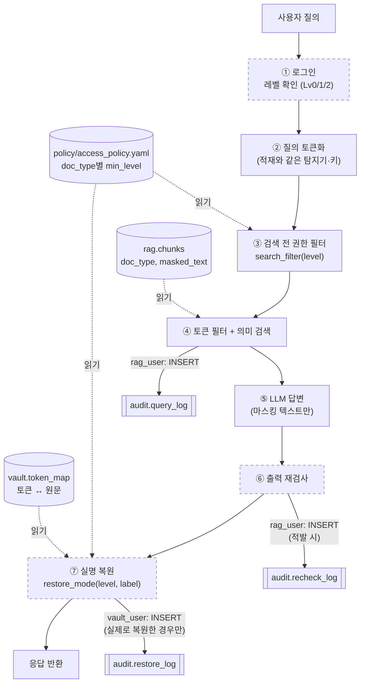
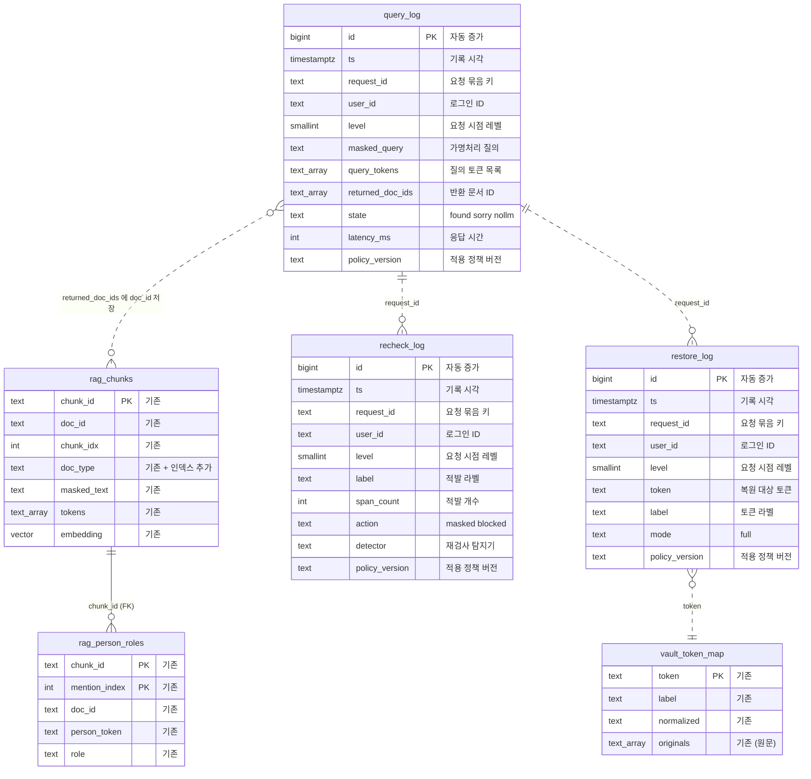
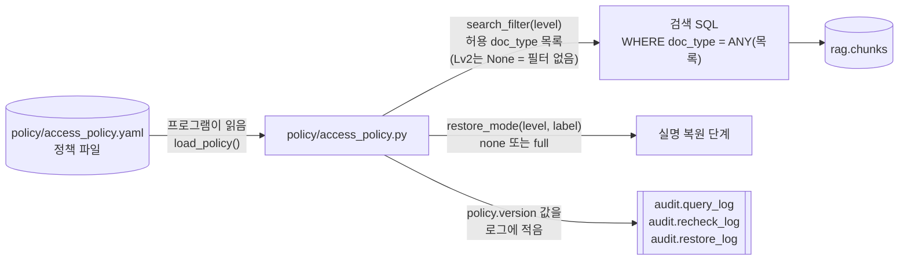

# 권한 정책 데이터 구조 (초안)

작성: 정민영 · 2026-11-06 · 정책 v0.3 기준
상태: **팀 확정 전 초안**. 감사 로그 SQL은 `policy/draft/03_audit_log.sql`에 있고, 아직 `infra/init/`에 넣지 않았습니다.

관련 파일
- 다이어그램 이미지(Mermaid가 안 보이는 환경용): `docs/img/permission_schema_flow.png`, `docs/img/permission_schema_erd.png`
- 정책서(사람이 읽는 설명): `docs/permission_policy_draft.md`
- 정책 파일(코드가 읽는 단일 출처): `policy/access_policy.yaml`
- 정책 조회 모듈: `policy/access_policy.py`
- 감사 로그 스키마 초안: `policy/draft/03_audit_log.sql`

## 1. 한눈에 보기

권한 정책 담당으로 설계한 것은 두 가지입니다.

| 구분 | 형태 | 역할 |
|---|---|---|
| 권한 정책 | **파일** (`access_policy.yaml`) | 레벨별로 볼 수 있는 doc_type과 복원 규칙을 정함 |
| 감사 로그 | **DB 테이블 3개** (`audit` 스키마) | 조회·재검사·복원을 기록함 (쓰기만 가능, 원문 저장 금지) |

정책을 DB 테이블로 두지 않은 이유: 출처를 하나(YAML)로 유지하기 위해서입니다. 로그에는 판단에 사용한 `policy_version`만 남기면 Git 이력으로 재현할 수 있습니다. DB 정책 테이블 안은 `policy/draft/optional/`에 보관해 두었습니다(RLS 등 확장 시 사용).

## 2. 처리 흐름

질문 하나가 처리될 때 정책 파일과 각 테이블이 쓰이는 위치입니다. 점선 상자는 아직 구현되지 않은 단계입니다.

| 단계 | 정책·테이블 | 사용하는 계정 | 비고 |
|---|---|---|---|
| ③ 권한 필터 | `access_policy.yaml` → `search_filter(level)` | (파일) | Lv0/Lv1은 허용 doc_type 목록, Lv2는 필터 없음 |
| ④ 검색 | `rag.chunks` 읽기, `audit.query_log` 쓰기 | `rag_user` | `AND doc_type = ANY(허용 목록)` 추가 |
| ⑥ 재검사 | `audit.recheck_log` 쓰기 | `rag_user` | 적발된 경우만 기록 |
| ⑦ 복원 | `access_policy.yaml` → `restore_mode()`, `vault.token_map` 읽기, `audit.restore_log` 쓰기 | `vault_user` | 현재는 Lv2만 `full`. **실제로 복원한 경우에만 기록** (Lv0·Lv1은 복원이 없으므로 기록 없음) |

## 3. ERD

ERD에는 **DB 테이블만** 그립니다. 정책 파일(YAML)은 DB 테이블이 아니어서 SQL로 JOIN할 수 없고, 프로그램이 읽어서 값으로 넘깁니다. 그 경로는 아래 3.2절에 따로 그렸습니다.

### 3.1 DB 테이블 관계

`PK`는 기본키입니다. 실선은 DB 외래키, 점선은 **외래키 없이 값으로만 연결되는 관계**(논리적 관계)입니다. 감사 로그는 원본 데이터가 지워지거나 다시 적재되어도 남아야 하므로 외래키를 걸지 않습니다.

다이어그램 표기 참고: Mermaid에서 배열 타입을 쓸 수 없어 `text[]`를 `text_array`로, 스키마 구분점(`.`)을 `_`로 적었습니다(예: `rag_chunks` = `rag.chunks`).

### 3.2 정책 파일이 쓰이는 경로 (JOIN 아님)

- SQL은 정책 파일을 모릅니다. 프로그램이 계산한 **허용 목록을 값으로** 받을 뿐입니다.
- 로그의 `policy_version`은 판단에 쓴 정책 버전을 적어 둔 이름표입니다. 내용은 Git 이력에서 해당 버전의 YAML을 열어 확인합니다.
- DB 정책 테이블(권한 마스터)은 두지 않습니다. RLS 도입 등이 정해지면 `policy/draft/optional/`의 안을 추가합니다.

## 4. 테이블 정의 (신규: `audit` 스키마)

공통 규칙
- 원문 개인정보는 어떤 컬럼에도 저장하지 않습니다. 질의는 가명처리된 텍스트, 개인정보는 토큰만 기록합니다.
- 쓰기 계정은 **INSERT만** 가능하고, 읽기·수정·삭제는 관리자만 할 수 있습니다. 그래서 앱에서 `INSERT ... RETURNING`은 쓸 수 없습니다.
- `request_id`로 한 요청의 세 로그를 묶습니다.
- `level`은 요청 시점의 레벨을 복사해 둡니다. 나중에 사용자 레벨이 바뀌어도 당시 판단을 재현할 수 있습니다.
- `user_id`는 로그인 ID 문자열(예: `demo_lv1`)이며, 로그인 테이블과 외래키로 잇지 않습니다.

### 4.1 `audit.query_log` — 조회 로그

근거: 계획서 3절 "평가·감사용 로그에는 가명처리된 질의, 검색 결과, 응답 시간, 재검사 결과만 기록"
쓰는 계정: `rag_user` (INSERT만) · 기록 시점: 검색 후 응답 직전, 요청마다 1행

| 컬럼 | 타입 | NULL | 제약·기본값 | 설명 |
|---|---|---|---|---|
| `id` | BIGINT | N | PK, 자동 증가 | 행 번호 |
| `ts` | TIMESTAMPTZ | N | 기본값 `now()` | 기록 시각 |
| `request_id` | TEXT | N | | 한 요청의 조회·재검사·복원 로그를 잇는 키 |
| `user_id` | TEXT | N | | 로그인 ID |
| `level` | SMALLINT | N | 0~2 | 요청 시점의 권한 레벨 |
| `masked_query` | TEXT | N | | 가명처리된 질의 (원문 금지) |
| `query_tokens` | TEXT[] | N | 기본값 `{}` | 질의에서 나온 토큰 목록 |
| `returned_doc_ids` | TEXT[] | N | 기본값 `{}` | 사용자에게 반환한 문서 ID ("권한 밖 문서 노출 0건" 검증용) |
| `state` | TEXT | Y | `found` / `sorry` / `nollm` | 응답 상태 (`service/app.py`와 같은 값) |
| `latency_ms` | INT | Y | 0 이상 | 응답 시간(ms) |
| `policy_version` | TEXT | N | | 판단에 사용한 정책 버전 |

인덱스: `ts`, `(user_id, ts)`

### 4.2 `audit.recheck_log` — 출력 재검사 적발 로그

근거: 계획서 3절 "복원 요청과 출력 재검사 적발 건은 사용자·시각·토큰 단위로 감사 로그에 기록"
쓰는 계정: `rag_user` (INSERT만) · 기록 시점: 재검사에서 개인정보가 적발된 경우, 라벨마다 1행

| 컬럼 | 타입 | NULL | 제약·기본값 | 설명 |
|---|---|---|---|---|
| `id` | BIGINT | N | PK, 자동 증가 | 행 번호 |
| `ts` | TIMESTAMPTZ | N | 기본값 `now()` | 기록 시각 |
| `request_id` | TEXT | N | | 요청 묶음 키 |
| `user_id` | TEXT | N | | 로그인 ID |
| `level` | SMALLINT | N | 0~2 | 요청 시점의 권한 레벨 |
| `label` | TEXT | N | | 적발된 개인정보 라벨 (예: `person`) |
| `span_count` | INT | N | 1 이상 | 해당 라벨의 적발 개수 |
| `action` | TEXT | N | `masked` / `blocked` | 조치 (가림 / 답변 차단) |
| `detector` | TEXT | Y | | 재검사에 쓴 탐지기 (예: `koelectra_post_kiwi_split_v3`) |
| `policy_version` | TEXT | N | | 적용 정책 버전 |

인덱스: `ts`
적발된 원문 문자열은 기록하지 않고, 라벨과 개수만 남깁니다.

### 4.3 `audit.restore_log` — 실명 복원 로그

근거: 계획서 5절 "실명 복원은 Lv2에서만 허용하며 복원 이력을 감사 로그로 기록"
쓰는 계정: `vault_user` (INSERT만) · 기록 시점: **복원을 실제로 수행한 경우에만**, 복원한 토큰마다 1행 (복원이 일어나지 않는 Lv0·Lv1 요청은 기록하지 않음)

| 컬럼 | 타입 | NULL | 제약·기본값 | 설명 |
|---|---|---|---|---|
| `id` | BIGINT | N | PK, 자동 증가 | 행 번호 |
| `ts` | TIMESTAMPTZ | N | 기본값 `now()` | 기록 시각 |
| `request_id` | TEXT | N | | 요청 묶음 키 |
| `user_id` | TEXT | N | | 로그인 ID |
| `level` | SMALLINT | N | 0~2 | 요청 시점의 권한 레벨 |
| `token` | TEXT | N | 토큰 형식만 허용 (`<라벨_64자리hex>`) | 복원 대상 토큰. 실명을 넣으면 DB가 거부함 |
| `label` | TEXT | N | | 토큰의 라벨 |
| `mode` | TEXT | N | `full` | 적용된 복원 모드. 현재 값은 `full` 하나이며, 부분 복원(`partial`)을 도입하면 값을 추가 |
| `policy_version` | TEXT | N | | 적용 정책 버전 |

인덱스: `ts`, `(user_id, ts)`

### 4.4 요청 한 건당 어떤 로그가 쓰이는가

| 상황 | `query_log` | `recheck_log` | `restore_log` |
|---|---|---|---|
| Lv0 질문 | 1행 | 재검사에서 적발되면 | 기록 안 함 (복원 없음) |
| Lv1 질문 | 1행 | 재검사에서 적발되면 | 기록 안 함 (복원 없음) |
| Lv2 질문 | 1행 | 재검사에서 적발되면 | 복원한 토큰마다 1행 |

- Lv0·Lv1에서 복원이 차단된 사실은 별도로 기록하지 않습니다. `query_log`의 `level`과 `policy_version`으로 정책 파일에서 다시 계산할 수 있습니다.
- Lv2에서 복원이 일어나지 않은 경우(예: 재검사에서 답변이 차단됨)는 `recheck_log`의 `action = blocked`나 `query_log.state`로 구분합니다.

### 4.5 계정별 권한

| 대상 | `rag_user` | `vault_user` | 관리자(admin) |
|---|---|---|---|
| `audit.query_log` | INSERT | - | 전체 |
| `audit.recheck_log` | INSERT | - | 전체 |
| `audit.restore_log` | - | INSERT | 전체 |
| `rag.*` (기존) | 전체 | - | 전체 |
| `vault.*` (기존) | - | 전체 | 전체 |

Lv2의 감사 로그 확인은 당분간 관리자 계정으로 실행하는 조회 스크립트로 합니다. 웹 화면이 필요해지면 읽기 전용 계정을 추가합니다.

## 5. 정책 파일 구조 (`policy/access_policy.yaml`)

DB 테이블은 아니지만 권한 판단의 기준이므로 구조를 함께 적습니다.

| 항목 | 형식 | 설명 |
|---|---|---|
| `version` | 문자열 | 정책 버전. 감사 로그의 `policy_version`에 기록됨. 내용을 바꾸면 올려야 함 |
| `updated`, `status` | 문자열 | 수정일, 검토 상태 |
| `levels` | 레벨 → {`name`, `description`} | Lv0~2 정의 |
| `hierarchical` | true | 상위 레벨이 하위 레벨 권한을 포함 |
| `defaults.unregistered_min_level` | 2 | 정책에 없는 doc_type의 최소 레벨 (기본 거부) |
| `doc_types` | doc_type → {`min_level`, `rule`, `rationale`, `note`} | 33종의 열람 최소 레벨, 판정 규칙 번호, 근거 |
| `restore` | 레벨 → 라벨 → `none`/`full` | 복원 규칙 (현재 Lv2만 `full`) |
| `audit_log_read_min_level` | 2 | 감사 로그를 확인할 수 있는 최소 레벨 |

조회 함수 (`policy/access_policy.py`)

| 함수 | 반환 | 용도 |
|---|---|---|
| `search_filter(level)` | 허용 doc_type 목록 또는 `None` | **검색 필터에는 이 함수를 사용.** Lv2는 `None`(필터 없음) |
| `can_view(level, doc_type)` | bool | 문서 하나의 열람 가능 여부 |
| `restore_mode(level, label)` | `none` / `full` | 복원 여부 |
| `can_read_audit_log(level)` | bool | 감사 로그 확인 가능 여부 |
| `allowed_doc_types(level)` | 등록된 doc_type 목록 | 참고용. 미등록 유형이 빠지므로 검색 필터에는 쓰지 않음 |

## 6. 이 문서에 없는 것 (다른 담당 영역)

| 데이터 | 상태 | 담당 | 필요 시점 |
|---|---|---|---|
| 로그인 계정 (`auth.users` 등) | 미설계 | 로그인·권한 구현 담당 | 1차 시연 전. 시연용 고정 계정이면 테이블 없이도 가능 |
| 직원 목록 (ID·팀·직급) | 미설계 | 직원 목록 설계 담당 | 2차(담당 팀 기준) 도입 시 |
| 문서 메타 (`doc_meta`: 담당 팀·직원, 지역) | 미설계 | 메타데이터 생성 담당 | 2차 도입 시 |

2차 기준을 도입할 때 확인할 것: "팀장 이상"(직급)과 Lv0~2의 관계, doc_type 기준과 담당 팀 기준의 결합 방식(AND 등), 담당자가 여러 명일 때의 판정 기준.
