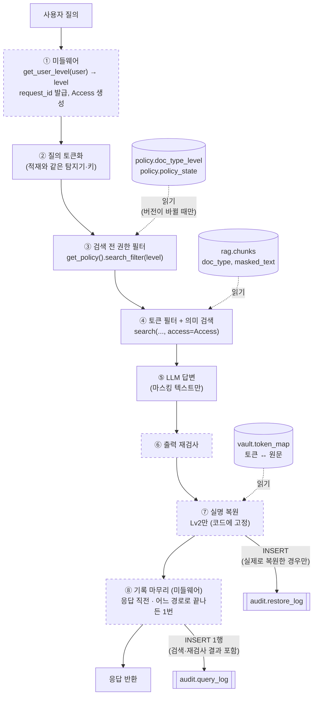
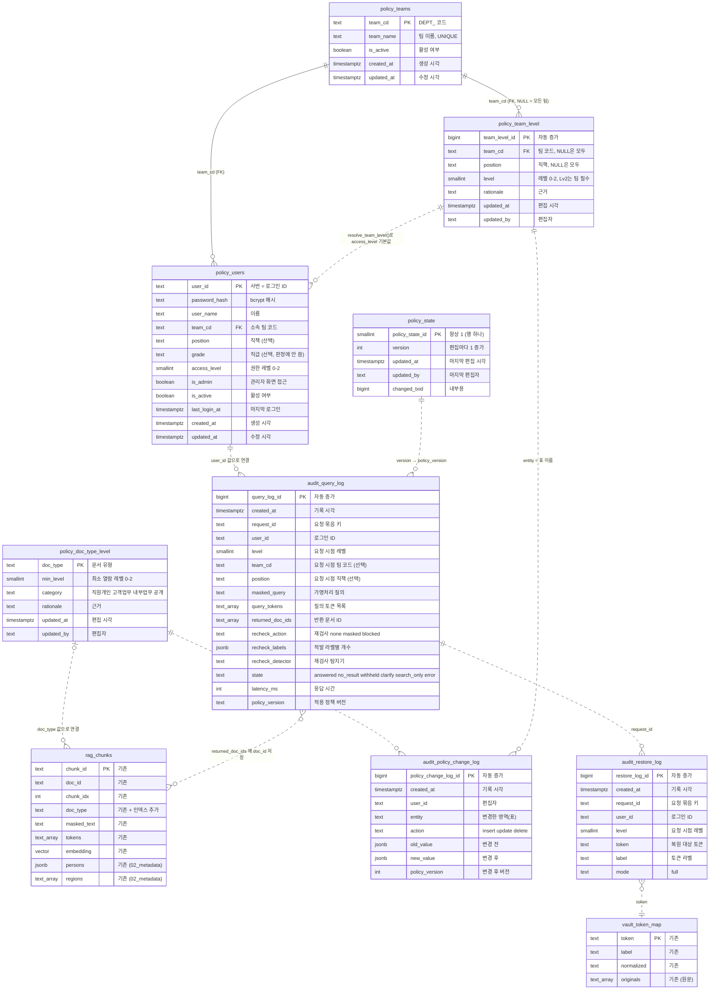
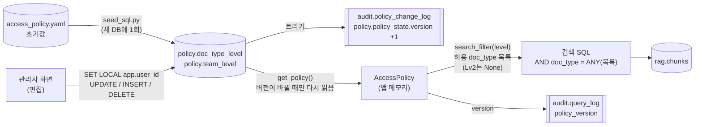

# 권한 정책 데이터 구조 (초안)

2026-11-06 작성 · 2026-11-09 정책 DB 이관 반영 · 2026-11-10 팀·직책 레벨 규칙, 이름 정리 반영 · 2026-11-11 팀·계정 테이블(`teams`, `users`) 추가
상태: **설계 기록**. 2026-11-12부터 DB 스키마는 develop의 `infra/init/04~07`이 기준입니다. 4·5절의 표·트리거 설명 중 develop에 없는 항목(아래 '고도화 후보')은 아직 적용되지 않았습니다.

관련 파일
- 정책서(사람이 읽는 설명, 결정 사항): `docs/permission_policy_draft.md` (9절)
- **DB 스키마의 기준(2026-11-12~)**: develop의 `infra/init/04_policy.sql`(정책·계정 테이블), `05_audit.sql`(감사 로그·변경 이력 트리거), `06_grants.sh`(DB 계정), `07_seed_demo_users.sql`(시연 계정 `SB260001`~`SB260010`). 이 문서의 표 정의가 그 파일과 다르면 파일이 맞습니다
- (삭제됨) 이전 초안 `policy/draft/05_audit_log.sql`·`06_policy_tables.sql`은 develop의 `05_audit.sql`·`04_policy.sql`로 대체되어 지웠습니다(Git 기록에는 남아 있음)
- 정책 초기값: `policy/access_policy.yaml` → `python -m policy.seed_sql` → `policy/draft/07_policy_seed.sql` (develop `04_policy.sql` 적용 후 수동 실행. 자동 실행 위치는 팀 결정 대기)
- 정책 조회 모듈: `policy/access_policy.py` (지금은 YAML을 읽음, DB 읽기는 구현 예정)
- 이전 초안 기준 그림(DB 관계도·흐름도 PNG, 원본 HTML)은 develop DDL과 달라 Git에서 빼고 로컬(`results/Claude outputs/permission_img/`)에만 보관합니다

## 1. 한눈에 보기

권한 정책 담당으로 설계한 것은 두 가지 스키마입니다.

| 스키마 | 테이블 | 역할 |
|---|---|---|
| `policy` (신규) | `doc_type_level`, `team_level`, `policy_state`, `teams`, `users` | 레벨별로 볼 수 있는 doc_type, 팀·직책별 사용자 레벨 규칙, 정책 버전, 팀 목록, 로그인 계정. **관리자 화면에서 편집** |
| `audit` (신규) | `query_log`, `restore_log`, `policy_change_log` | 질문(재검사 결과 포함)·복원·정책 변경 기록 (원문 저장 금지) |

테이블 분류

| 분류 | 뜻 | 테이블 |
|---|---|---|
| 마스터 | 업무 기준이 되는 대상의 목록과 속성. 드물게 바뀌고 관리자가 바꿈 | `policy.doc_type_level`(권한 마스터), `policy.team_level`(사용자 레벨 규칙), `policy.teams`(팀), `policy.users`(로그인 계정) |
| 상태 | 현재 값 하나를 담는 관리용 표 | `policy.policy_state` |
| 이력 | 일이 생길 때마다 계속 쌓이는 표 | `audit.*` 3개 |

레벨(0/1/2) 정의는 편집하지 않으므로 표로 두지 않고, 각 표의 `CHECK (0~2)` 제약과 코드에 고정합니다.

바뀐 점 (2026-11-09, 정책서 9절 결정 3)
- 관리자 화면에서 권한 그룹을 편집하기로 해서, **정책의 원본이 YAML에서 DB 테이블로 바뀌었습니다.**
- `access_policy.yaml`은 새 DB에 처음 한 번 넣는 **초기값(시드)**입니다.
- 화면에서 편집하지 못하게 고정한 것: 레벨 개수(0/1/2), 미등록 doc_type은 Lv2 전용, 실명 복원 규칙(Lv2만 전체 복원). 잘못 바꾸면 개인정보가 바로 노출되는 항목이라 코드에 둡니다.

바뀐 점 (2026-11-10, 정책서 9절 결정 12)
- 사용자 레벨을 팀뿐 아니라 **직책**(팀장·팀원 등)으로도 나눌 수 있게, 팀별 기본 레벨 표에 직책 조건을 더해 **팀·직책 규칙 표(`team_level`)**로 바꿨습니다. 직급(사원·과장 등)은 쓰지 않습니다.
- 초기값은 기존 팀 규칙 10개를 그대로 옮긴 것이라 지금 결과는 같습니다.

사용자별 레벨은 로그인 계정 테이블 `policy.users`의 `access_level`에 저장합니다(5.6절, 정책서 9절 결정 15).

## 2. 처리 흐름

질문 하나가 처리될 때 각 테이블이 쓰이는 위치입니다. 점선 상자는 아직 구현되지 않은 단계입니다.



| 단계 | 사용하는 테이블·함수 | 비고 |
|---|---|---|
| ① 미들웨어 | 로그인 계정의 `access_level`(`policy.users`) → `get_user_level(user)` | 질문마다 레벨 조회 1회, `request_id` 1개 발급. `Access`(user_id, level, team_cd, position, request_id, policy_version) 객체를 만들어 이후 단계에 넘김. 팀·직책은 기록용이고 판단에는 `level`만 씀 |
| ③ 권한 필터 | `policy.doc_type_level`, `policy.policy_state` → `get_policy()` | 정책을 캐시해 두고, `policy_state.version`이 바뀌었을 때만 다시 읽음. Lv0/Lv1은 허용 doc_type 목록, Lv2는 필터 없음 |
| ④ 검색 | `rag.chunks` 읽기 | `access`는 **필수 인자**(정책서 9절 결정 4). SQL 세 경로(AND·토큰 없음·boost) 모두에 `AND doc_type = ANY(허용 목록)`을 `LIMIT` 전에 추가. 결과(질의 토큰, 반환 문서)는 메모리에 보관 |
| ⑥ 재검사 | (없음) | 결과(조치, 라벨별 개수, 탐지기)를 메모리에 보관 |
| ⑦ 복원 | `vault.token_map` 읽기, `audit.restore_log` 쓰기 | Lv2만 `full`. **실제로 복원한 경우에만 기록**하며, 기록에 실패하면 복원하지 않음 |
| ⑧ 기록 마무리 | `audit.query_log` 쓰기 | 미들웨어가 응답 직전에 **한 번** 씀(`finally`). 결과 없음·LLM 없음·지역 되묻기·오류로 일찍 끝나도 반드시 1행. 기록에 실패해도 답변은 돌려주고 서버 오류 로그에 남김 |

권한 밖 문서만 있어서 결과가 없을 때도 "일치하는 문서를 찾지 못했습니다"를 그대로 씁니다. "권한 밖 문서 N건 제외" 같은 안내는 하지 않습니다(문서 존재 비노출, 정책서 9절 결정 5).

## 3. ERD

### 3.1 테이블 관계

`PK`는 기본키, `FK`는 외래키입니다. 실선은 외래키, 점선은 **외래키 없이 값으로만 연결되는 관계**(논리적 관계)입니다. 외래키는 팀 코드(`teams.team_cd`)를 참조하는 2개뿐입니다.
- 감사 로그는 원본 데이터가 지워지거나 다시 적재되어도 남아야 하므로 외래키를 걸지 않습니다.
- `rag.chunks.doc_type`과 `policy.doc_type_level`도 외래키로 잇지 않습니다. 정책에 없는 doc_type(신규 템플릿, NULL)도 적재할 수 있어야 하고, 이런 문서는 Lv2 전용으로 처리합니다.



다이어그램 표기 참고: Mermaid에서 배열 타입을 쓸 수 없어 `text[]`를 `text_array`로, 스키마 구분점(`.`)을 `_`로 적었습니다(예: `policy_doc_type_level` = `policy.doc_type_level`). 이전 판의 `rag.person_roles`는 `02_metadata.sql`에서 삭제되어(`rag.chunks.persons`로 대체) 그림에서 뺐습니다.

### 3.2 정책이 쓰이는 경로



- 검색 SQL은 정책 테이블을 JOIN하지 않습니다. 앱이 미리 계산한 **허용 목록을 값으로** 넘깁니다. 정책은 33행뿐이라 앱이 캐시하는 쪽이 단순하고, 검색 SQL의 HNSW 후보 고정 구조도 그대로 유지됩니다.
- Lv2는 필터를 걸지 않으므로 미등록·NULL doc_type 문서도 검색됩니다. 허용 목록만 쓰면 Lv2에서 이 문서들이 빠지므로 `search_filter()`를 써야 합니다.
- 나중에 DB 안에서 직접 판단할 때(RLS 검토, 정책서 9절 결정 6)는 아래 식을 씁니다. 미등록·NULL은 Lv2로 처리합니다.
  `COALESCE((SELECT min_level FROM policy.doc_type_level a WHERE a.doc_type = c.doc_type), 2) <= :level`

## 4. 감사 로그 테이블 (`audit` 스키마, develop `infra/init/05_audit.sql`)

공통 규칙
- 원문 개인정보는 어떤 컬럼에도 저장하지 않습니다. 질의는 가명처리된 텍스트, 개인정보는 토큰만 기록합니다.
- 앱 계정은 **INSERT만** 할 수 있게 설계했습니다(6절). 그래서 앱에서 `INSERT ... RETURNING`은 쓸 수 없습니다.
- `level`은 요청 시점의 레벨을 복사해 둡니다. 나중에 사용자 레벨이 바뀌어도 당시 판단을 재현할 수 있습니다.
- `user_id`는 로그인 ID 문자열(예: `demo_lv1`)이며, 로그인 테이블과 외래키로 잇지 않습니다.
- `query_log.policy_version`에는 `policy.policy_state.version` 값을 문자열로 적습니다. 그 시점의 정책 내용은 `audit.policy_change_log`를 거슬러 올라가 재현합니다.
- **`request_id`로 한 질문의 로그를 묶습니다.** 미들웨어가 질문마다 번호를 하나 만들어 `query_log`와 `restore_log`에 같은 값을 적습니다. 재검사 결과는 `query_log`의 같은 행에 들어 있습니다. 예를 들어 `demo_lv2`의 질문 하나에 `req-7f3a`가 붙었다면:

  | 테이블 | 기록된 행 |
  |---|---|
  | `query_log` | `req-7f3a` / demo_lv2 / Lv2 / 반환 문서 D0012, D0031 / 재검사 `masked`, `{"phone_number": 1}` |
  | `restore_log` | `req-7f3a` / demo_lv2 / `<PERSON_ab12…>` / full |
  | `restore_log` | `req-7f3a` / demo_lv2 / `<PERSON_c9e0…>` / full |

  `req-7f3a`로 찾으면 "문서 2건 반환, 전화번호 1건 가림, 실명 2명 복원"을 한 번에 재구성할 수 있습니다. 같은 사람이 짧은 간격으로 여러 번 질문해도 어느 복원이 어느 질문에서 나왔는지 구분됩니다.

### 4.1 `audit.query_log` — 조회 로그

근거: 계획서 3절 "평가·감사용 로그에는 가명처리된 질의, 검색 결과, 응답 시간, 재검사 결과만 기록", "출력 재검사 적발 건은 사용자·시각·토큰 단위로 감사 로그에 기록"
기록 시점: 미들웨어가 **응답 직전에 질문마다 1행**. 어느 경로로 끝나든(결과 없음·LLM 없음·지역 되묻기·오류) 반드시 남깁니다.

| 컬럼 | 타입 | NULL | 제약·기본값 | 설명 |
|---|---|---|---|---|
| `query_log_id` | BIGINT | N | PK, 자동 증가 | 행 번호 |
| `created_at` | TIMESTAMPTZ | N | 기본값 `now()` | 기록 시각(응답 직전). 질문 시작 시각은 `created_at - latency_ms` |
| `request_id` | TEXT | N | UNIQUE | `restore_log`와 잇는 키 (질문마다 1개, 중복 불가) |
| `user_id` | TEXT | N | | 로그인 ID |
| `level` | SMALLINT | N | 0~2 | 요청 시점의 권한 레벨 |
| `team_cd` | TEXT | Y | | 요청 시점의 소속 팀 코드. 감사 분석과 ABAC 전환 근거 (신규) |
| `position` | TEXT | Y | | 요청 시점의 직책. 레벨 규칙(`team_level`) 판단 근거 (신규) |
| `masked_query` | TEXT | N | | 가명처리된 질의 (원문 금지) |
| `query_tokens` | TEXT[] | N | 기본값 `{}` | `search()`가 돌려준 질의 토큰 목록 (분석·평가용) |
| `returned_doc_ids` | TEXT[] | N | 기본값 `{}` | 사용자에게 반환한 문서 ID ("권한 밖 문서 노출 0건" 검증용) |
| `recheck_action` | TEXT | Y | `none` / `masked` / `blocked` | 재검사 조치. NULL = 재검사 전에 끝남, `none` = 적발 없음, `masked` = 가림, `blocked` = 답변 차단 |
| `recheck_labels` | JSONB | N | 기본값 `{}`, 객체만 | 적발된 라벨별 개수 (예: `{"phone_number": 1}`). 원문 문자열은 넣지 않음 |
| `recheck_detector` | TEXT | Y | | 재검사에 쓴 탐지기 (예: `koelectra_post_kiwi_split_v3`) |
| `state` | TEXT | N | 아래 6개 값 | 질문에 대한 최종 응답 상태. 아래 표 참고 |
| `latency_ms` | INT | Y | 0 이상 | 응답 시간(ms) |
| `policy_version` | TEXT | N | | 판단에 사용한 정책 버전 |

인덱스: `created_at`, `(user_id, created_at)`

`state` 값 (미들웨어가 위에서부터 차례로 판정. 화면 응답 `/api/chat`의 `found`/`sorry`/`nollm`과는 별개)

| 값 | 뜻 | 나타나는 상황 | 질문 예시 |
|---|---|---|---|
| `error` | 처리 실패 | DB 연결 실패, LLM 재시도 후에도 실패, 탐지 모델 오류 등 예외 | 어떤 질문이든 서버 문제가 있을 때 |
| `clarify` | 되물음 | 질문의 지역 이름이 여러 시·도에 겹침 | "중구 지점 민원 현황 알려줘" |
| `no_result` | 볼 수 있는 문서 없음 | 조건에 맞는 문서가 없거나, **권한 필터로 모두 빠짐**(사용자에게는 같은 문구) | "2019년 해외 지점 감사보고서 보여줘", Lv0 사용자의 고객 민원 질문 |
| `search_only` | 검색 결과만 | 문서는 있지만 서버에 LLM 키가 없음(개발·검색 평가 환경) | 키 없이 띄운 서버의 아무 질문 |
| `withheld` | 답변 보류 | 문서는 있지만 답이 문서에 없어 LLM이 확인 불가로 답함 | "홍길동 고객 대출 금리가 몇 %야?"(문서에 금리 없음) |
| `answered` | 답변함 | 문서를 근거로 LLM이 답함 | "홍길동 고객 카드 한도 상향 심사 결과 알려줘" |

- 순서가 중요합니다. `no_result` 안내 문구("찾지 못했습니다")에도 보류 문구가 들어 있어, 문서 0건을 먼저 확인해야 `withheld`로 잘못 분류되지 않습니다.
- `withheld`는 LLM 답변에 보류 문구("확인되지 않", "찾지 못", "보류", "확인할 수 없", "알 수 없")가 있는지로 판정합니다. 다른 표현이면 `answered`로 잡힐 수 있어 평가 리포트에 한계로 적습니다.

제약: `recheck_action`이 `masked`·`blocked`이면 `recheck_labels`에 라벨이 있어야 하고, 그 밖의 경우(`none`, NULL)에는 비어 있어야 합니다.

재검사 적발 건만 보려면 `WHERE recheck_action IN ('masked', 'blocked')`로 거릅니다. (이전 판의 `recheck_log`는 기록 단위가 질문 1건과 같아서 이 표에 합쳤습니다.)

### 4.2 `audit.restore_log` — 실명 복원 로그

근거: 계획서 5절 "실명 복원은 Lv2에서만 허용하며 복원 이력을 감사 로그로 기록"
기록 시점: **복원을 실제로 수행한 경우에만**, 복원한 토큰마다 1행

| 컬럼 | 타입 | NULL | 제약·기본값 | 설명 |
|---|---|---|---|---|
| `restore_log_id` | BIGINT | N | PK, 자동 증가 | 행 번호 |
| `created_at` | TIMESTAMPTZ | N | 기본값 `now()` | 기록 시각 |
| `request_id` | TEXT | N | | 요청 묶음 키 |
| `user_id` | TEXT | N | | 로그인 ID |
| `level` | SMALLINT | N | 0~2 | 요청 시점의 권한 레벨 |
| `token` | TEXT | N | 토큰 형식만 허용 (`<라벨_64자리hex>`) | 복원 대상 토큰. 실명을 넣으면 DB가 거부함 |
| `label` | TEXT | N | | 토큰의 라벨 |
| `mode` | TEXT | N | `full` | 적용된 복원 모드. 부분 복원(`partial`)을 도입하면 값을 추가 |

인덱스: `created_at`, `(user_id, created_at)`

정책 버전은 남기지 않습니다. 복원 규칙(Lv2만 전체 복원)은 코드에 고정이라 관리자가 편집하는 정책 버전과 관계가 없고, 그 질문의 정책 버전은 `request_id`로 `query_log`에서 확인합니다. `user_id`·`level`은 `query_log`에도 있지만, 복원 기록은 그 행만 봐도 "누가·언제·무엇을" 알 수 있도록 남깁니다.

### 4.3 `audit.policy_change_log` — 정책 변경 이력 (develop `infra/init/05_audit.sql`)

근거: 개인정보의 안전성 확보조치 기준 제5조(접근 권한의 변경 기록) 참고
기록 시점: 정책 테이블의 행이 추가·수정·삭제될 때마다 **트리거가** 1행 기록. 앱이 직접 쓰지 않습니다.

| 컬럼 | 타입 | NULL | 제약·기본값 | 설명 |
|---|---|---|---|---|
| `policy_change_log_id` | BIGINT | N | PK, 자동 증가 | 행 번호 |
| `created_at` | TIMESTAMPTZ | N | 기본값 `now()` | 기록 시각 |
| `user_id` | TEXT | N | | 편집한 관리자 ID (`app.user_id` 값, 초기값 적재는 예약값 `seed`) |
| `entity` | TEXT | N | | 변경한 영역(표). 예: `policy.doc_type_level`, `policy.team_level` |
| `action` | TEXT | N | `insert` / `update` / `delete` | 변경 종류 |
| `old_value` | JSONB | Y | | 변경 전 행 (insert면 NULL) |
| `new_value` | JSONB | Y | | 변경 후 행 (delete면 NULL) |
| `policy_version` | INT | Y | | 변경 후 정책 버전 |

인덱스: `created_at`

통계 분석용이 아닌 **기록용**이라 행 키 칸은 두지 않습니다. 어느 행이 바뀌었는지는 `old_value`·`new_value`(행 전체)에서 확인합니다(예: `new_value->>'doc_type'`).

### 4.4 요청 한 건당 어떤 로그가 쓰이는가

| 상황 | `query_log` | `restore_log` |
|---|---|---|
| Lv0 질문 | 1행 (재검사 결과 포함) | 기록 안 함 (복원 없음) |
| Lv1 질문 | 1행 (재검사 결과 포함) | 기록 안 함 (복원 없음) |
| Lv2 질문 | 1행 (재검사 결과 포함) | 복원한 토큰마다 1행 |
| 결과 없음·지역 되묻기·LLM 없음 | 1행 (`state` = `no_result`·`clarify`·`search_only`, `recheck_action` NULL) | 기록 안 함 |
| 처리 중 오류 | 1행 (`state = error`) | 오류 전에 복원했다면 그 행 |

- Lv0·Lv1에서 복원이 차단된 사실은 별도로 기록하지 않습니다. `query_log`의 `level`로 다시 계산할 수 있습니다(복원 규칙은 코드에 고정).
- 기록 순서는 `restore_log`(복원할 때)가 먼저, `query_log`(응답 직전)가 나중입니다. 둘은 `request_id`로 이어지므로 순서는 문제가 되지 않습니다.
- Lv2에서 복원이 일어나지 않은 경우(예: 재검사에서 답변 차단)는 `query_log.recheck_action = blocked`나 `state`로 구분합니다.

## 5. 정책 테이블 (`policy` 스키마, develop `infra/init/04_policy.sql`)

### 5.1 `policy.policy_state` — 정책 버전 (상태 테이블, 한 행)

| 컬럼 | 타입 | NULL | 제약·기본값 | 설명 |
|---|---|---|---|---|
| `policy_state_id` | SMALLINT | N | PK, 항상 `1` | 표에 행이 하나(1번 행)만 있도록 보장. 이력은 `audit.policy_change_log`에 있음 |
| `version` | INT | N | 0 이상, 기본값 0 | 정책 버전. 편집을 저장할 때마다 1 증가 (초기값 적재 후 1) |
| `updated_at` | TIMESTAMPTZ | N | 기본값 `now()` | 마지막 편집 시각 |
| `updated_by` | TEXT | Y | | 마지막 편집자 |
| `changed_txid` | BIGINT | Y | | 내부용. 한 번 저장(트랜잭션)에 버전이 두 번 오르지 않게 함 |

앱은 `version`만 자주 읽고, 캐시한 값과 다를 때만 `doc_type_level`를 다시 읽습니다.

### 5.2 `policy.doc_type_level` — doc_type별 최소 레벨 (권한 마스터, 편집 가능)

| 컬럼 | 타입 | NULL | 제약·기본값 | 설명 |
|---|---|---|---|---|
| `doc_type` | TEXT | N | PK, 앞뒤 공백·빈 문자열 금지 | 문서 유형 (화면에서 이름 변경 불가) |
| `min_level` | SMALLINT | N | 0~2 | 이 유형을 볼 수 있는 최소 레벨 |
| `category` | TEXT | N | `직원개인` / `고객업무` / `내부업무` / `공개` | 정책서 3절 판정 질문의 결과(어떤 종류의 문서인가). 기존 행에서는 수정 불가 |
| `rationale` | TEXT | N | | 판정 근거 (계획서와 다른 경우 여기에 적음) |
| `updated_at` | TIMESTAMPTZ | N | 트리거가 채움 | 편집 시각 |
| `updated_by` | TEXT | N | 트리거가 채움 | 편집자 |

- 분류(`category`)와 기본 레벨

  | 분류 | 판정 질문 | 기본 레벨 | 행 수 |
  |---|---|---|---|
  | 직원개인 | 2 | Lv2 | 4 |
  | 고객업무 | 3 | Lv1 | 18 |
  | 내부업무 | 4 | Lv1 | 7 |
  | 공개 | 5 | Lv0 | 4 |

  판정 질문 1(미등록)은 행이 없는 경우라 분류 값이 없고 Lv2로 처리합니다. 순서(위에서부터 처음 해당하는 질문)는 사람이 분류할 때의 절차이며, DB에는 결과만 저장합니다.
- 안전장치(CHECK `doc_type_level_floor`): `min_level`은 분류의 기본 레벨 이상이어야 합니다. **올리기만 가능하고 내릴 수는 없습니다.** 직원 개인 문서는 항상 Lv2이고, 고객업무·내부업무는 Lv0으로 내릴 수 없습니다. 같은 규칙을 `load_policy()`(초기값 YAML 검증)도 적용합니다(정책서 9절 결정 8).
- 기존 행의 `doc_type`(이름)과 `category`는 수정할 수 없습니다(트리거). 분류를 바꿔 위 안전장치를 피하는 실수를 막기 위함입니다. 분류가 잘못되었다면 행을 삭제한 뒤 올바른 분류로 다시 추가하며, 삭제와 추가는 모두 변경 이력에 남습니다. 이 장치는 **실수 방지**이고, 관리자가 의도적으로 삭제 후 다른 분류로 다시 넣는 것까지 막지는 못합니다. 그 경우는 변경 이력으로 추적합니다.
- 행을 지우면 그 유형은 미등록이 되어 Lv2 전용으로 바뀝니다. 지워도 노출 범위가 넓어지지 않습니다.
- 정책에 없는 유형의 기본값(Lv2)은 이 표에 두지 않고 코드에 고정합니다.
- 마스터이지만 `rag.chunks.doc_type`이 외래키로 참조하지는 않습니다. 정책에 없는 새 유형도 적재되어야 하기 때문입니다(값으로만 연결).
- doc_type 하나에 규칙이 하나뿐이라 "문서 유형 목록"과 "권한 규칙"을 한 표로 합쳤습니다. 같은 유형에 조건이 여러 개 붙게 되면(예: 팀별 예외) 나눕니다.

### 5.3 `policy.team_level` — 사용자 레벨 규칙 (팀·직책, 편집 가능)

팀과 직책 조합으로 계정의 기본 레벨을 정합니다(정책서 9절 결정 12). 직급(`users.grade`)은 쓰지 않습니다.

| 컬럼 | 타입 | NULL | 제약·기본값 | 설명 |
|---|---|---|---|---|
| `team_level_id` | BIGINT | N | PK, 자동 증가 | 행 번호 |
| `team_cd` | TEXT | Y | FK → `policy.teams.team_cd` | 팀 코드(`DEPT_*`). NULL = 모든 팀 |
| `position` | TEXT | Y | 앞뒤 공백·빈 문자열 금지 | 직책 (예: 팀장, 팀원). NULL = 모든 직책 |
| `level` | SMALLINT | N | 0~2 | 조건에 맞는 계정의 기본 레벨 |
| `rationale` | TEXT | N | | 근거 |
| `updated_at` | TIMESTAMPTZ | N | 트리거가 채움 | 편집 시각 |
| `updated_by` | TEXT | N | 트리거가 채움 | 편집자 |

제약
- `team_level_unique`: 같은 팀·직책 조합은 한 행만(NULL끼리도 같은 값으로 봄)
- `team_level_has_condition`: 팀·직책 중 하나는 있어야 함. 전 직원 기본값(Lv0)은 코드에 고정
- `team_level_lv2_needs_team`: **Lv2 규칙에는 팀이 있어야 함.** "팀장이면 Lv2"처럼 모든 팀에 실명 열람 권한을 주는 규칙을 막음(정책서 7.1 원칙 3)
- 기존 행의 팀·직책은 수정할 수 없음(트리거 `policy.guard_team_level()`). 레벨·근거만 고치고, 조건이 다르면 삭제 후 새로 추가

판정 (`policy.resolve_team_level(team_cd, position)`, Python `default_level_for(team_cd, position)`가 같은 규칙)
1. 팀·직책이 맞는 규칙을 모두 찾습니다. NULL 칸은 무엇과도 맞습니다.
2. 채워진 칸이 많은(더 구체적인) 규칙을 씁니다. 팀+직책 > 팀만 = 직책만
3. 구체성이 같으면 **낮은 레벨**을 씁니다(권한이 넓어지는 쪽을 피함).
4. 맞는 규칙이 없으면 Lv0입니다.

예시 (초기값은 팀 규칙 10개뿐이며, 아래 직책 규칙은 설명용)

| 규칙 | 계정 | 결과 |
|---|---|---|
| `DEPT_IT_OPS/*` = 0, `DEPT_IT_OPS/팀장` = 1 | DEPT_IT_OPS 팀원 | 0 (팀 규칙) |
| 〃 | DEPT_IT_OPS 팀장 | 1 (팀+직책이 더 구체적) |
| `DEPT_DIGITAL/*` = 0, `*/팀장` = 1 | DEPT_DIGITAL 팀장 | 0 (구체성 같음 → 낮은 레벨) |
| `*/팀장` = 2 | | **거부** (Lv2인데 팀 없음) |

- 계정을 만들 때 기본 레벨을 계산하는 데만 씁니다. 팀·직책이 바뀌어도 자동으로 다시 계산하지 않습니다. **검색은 계정의 `access_level`만 봅니다.** 그래서 이 표를 고쳐도 기존 사용자의 레벨은 자동으로 바뀌지 않습니다(권한이 의도치 않게 넓어지는 것 방지).

### 5.4 편집 규칙 (트리거)

`doc_type_level`, `team_level`을 편집하면 트리거 `policy.record_change()`가 다음을 처리합니다. `teams`, `users`에도 같은 함수를 붙이되 **정책 버전은 올리지 않습니다**(5.5·5.6절).

| 처리 | 내용 |
|---|---|
| 편집자 확인 | 같은 트랜잭션에 `SET LOCAL app.user_id = '<관리자 ID>'`가 없으면 **편집 거부**. 변경 이력 없이 정책을 바꿀 수 없게 함 |
| 편집 시각·편집자 | `updated_at`, `updated_by`를 DB가 채움. 앱이 다른 값을 넣어도 덮어씀 |
| 버전 증가 | `policy_state.version` +1. 한 트랜잭션(저장 1회)에서 여러 행을 고쳐도 1만 증가 |
| 변경 이력 | `audit.policy_change_log`에 변경 전후 값 기록 |
| 이름·분류 보호 | `doc_type_level`의 `doc_type`, `category`는 수정 거부 (별도 트리거 `policy.guard_doc_type_level()`) |
| 규칙 조건 보호 | `team_level`의 `team_cd`, `position`은 수정 거부 (별도 트리거 `policy.guard_team_level()`) |
| 비밀번호 제외 | 변경 이력의 변경 전후 값에서 `password_hash`를 뺌 |
| 전체 삭제 차단 | `TRUNCATE`는 트리거를 거치지 않으므로 막음 (`teams`, `users` 포함) |

관리자 화면 API의 저장 예시:

```sql
BEGIN;
SET LOCAL app.user_id = 'admin01';
UPDATE policy.doc_type_level SET min_level = 2, rationale = '...' WHERE doc_type = '회의록';
INSERT INTO policy.team_level (team_cd, position, level, rationale)
VALUES ('DEPT_IT_OPS', '팀장', 1, '예시: IT운영팀 팀장 규칙');   -- updated_at·updated_by는 트리거가 채움
COMMIT;   -- 버전 1 증가, 변경 이력 2행
```

로그인 계정 테이블의 레벨 변경(WBS 3.3.3)에도 같은 트리거 함수를 붙이면 레벨 변경 이력이 같은 표에 남습니다(키 컬럼 `user_id`, 버전은 올리지 않음).

### 5.5 `policy.teams` — 팀 (마스터, 편집 가능)

정의 위치: `infra/init/04_policy.sql`. 변경 이력 트리거는 develop에 없습니다(고도화 후보).

| 컬럼 | 타입 | NULL | 제약·기본값 | 설명 |
|---|---|---|---|---|
| `team_cd` | TEXT | N | PK, 형식 `DEPT_<영문 대문자·숫자>` (CHECK `teams_cd_format`) | 팀 코드. 예: `DEPT_CREDIT` |
| `team_name` | TEXT | N | UNIQUE, 앞뒤 공백·빈 문자열 금지 | 팀 이름. 예: 여신심사팀 |
| `is_active` | BOOLEAN | N | 기본값 true | 활성 여부 |
| `created_at` | TIMESTAMPTZ | N | 기본값 `now()` | 생성 시각 |
| `updated_at` | TIMESTAMPTZ | N | 트리거가 채움 | 수정 시각 |

- `policy.team_level.team_cd`, `policy.users.team_cd`가 이 표를 외래키로 참조합니다. 규칙이나 계정이 가리키는 팀은 지울 수 없습니다. 팀을 없앨 때는 `is_active = false`로 둡니다.
- 팀 코드는 초기값(`access_policy.yaml`의 `teams`)과 정책서 7.3절 표에 있습니다. Python `load_policy()`도 같은 형식과 "규칙의 팀 코드는 팀 목록에 있어야 함"을 검사합니다.
- 변경은 `audit.policy_change_log`에 남고, 정책 버전은 올리지 않습니다(검색 필터와 무관).

### 5.6 `policy.users` — 로그인 계정 (마스터, 편집 가능)

정의 위치: `infra/init/04_policy.sql`. 시연 계정 10개는 `infra/init/07_seed_demo_users.sql`(사번 `SB260001`~`SB260010`, 비밀번호 `qwer0001`~`qwer0010`, bcrypt 해시로 저장).

| 컬럼 | 타입 | NULL | 제약·기본값 | 설명 |
|---|---|---|---|---|
| `user_id` | TEXT | N | PK, 앞뒤 공백·빈 문자열 금지 | 사번 = 로그인 ID. 예: `SB260001` |
| `password_hash` | TEXT | N | bcrypt 형식만 허용 (CHECK `users_password_bcrypt`) | 비밀번호 해시. 평문은 DB가 거부 |
| `user_name` | TEXT | N | 앞뒤 공백·빈 문자열 금지 | 이름 |
| `team_cd` | TEXT | N | FK → `policy.teams.team_cd` | 소속 팀 코드 |
| `position` | TEXT | Y | 앞뒤 공백·빈 문자열 금지 | **직책**(팀장·팀원). `team_level.position`과 같은 표기 |
| `grade` | TEXT | Y | 앞뒤 공백·빈 문자열 금지 | **직급**(사원·과장 등). 표시용, **레벨 판정에 쓰지 않음** |
| `access_level` | SMALLINT | N | 0~2 | 권한 레벨. 권한 판단의 유일한 기준값 (`access_level >= doc_type_level.min_level`이면 열람) |
| `is_admin` | BOOLEAN | N | 기본값 false | 관리자 화면 접근 여부. 레벨과 별개(정책서 9절 결정 9) |
| `is_active` | BOOLEAN | N | 기본값 true | 활성 여부. 퇴사·사용 중지(관리자가 변경) |
| `last_login_at` | TIMESTAMPTZ | Y | | 마지막 로그인 시각 |
| `created_at` | TIMESTAMPTZ | N | 기본값 `now()` | 생성 시각 |
| `updated_at` | TIMESTAMPTZ | N | 트리거가 채움 | 수정 시각 |

인덱스: `team_cd`

- 직무는 저장하지 않습니다.
- 로그인 실패 잠금(기능 목록 F-68)과 세션 자동 만료(F-03)는 고도화 때 추가합니다. 지금 스키마에는 관련 칸이 없습니다.
- `access_level` 채우기(앱이 함): 계정을 만들 때 `policy.resolve_team_level(team_cd, position)` 값으로 채웁니다. **이후에는 자동으로 다시 계산하지 않습니다.** 팀·직책이 바뀌면(승진, 부서 이동) 관리자가 레벨을 직접 고칩니다. 그래서 관리자가 직접 정한 레벨(예: 제한을 위해 낮춘 레벨)이 덮어써지지 않으며, 레벨 출처 컬럼(`rule`/`manual`)도 두지 않습니다(정책서 9절 결정 15).
- 변경 이력: 이름·팀·직책·직급·레벨·관리자 표시·활성 여부가 바뀌거나 계정을 만들고 지울 때 `audit.policy_change_log`에 남습니다(`SET LOCAL app.user_id` 필요, 정책 버전은 그대로). `password_hash`는 이력에서 빠지며, 로그인 시각·비밀번호 변경은 기록하지 않고 편집자도 요구하지 않습니다.
- 다른 정책 표의 레벨 컬럼(`team_level.level`, 감사 로그의 `level`)은 이름을 바꾸지 않았습니다. 감사 로그 `level`에는 요청 시점의 `access_level` 값을 복사합니다.

## 6. 계정별 권한 설계 (적용은 WBS 3.4.1 구현 단계)

지금은 스키마 설계까지가 범위라 **계정과 권한은 만들지 않았습니다**(계정과 권한은 develop의 `infra/init/06_grants.sh`로 확정. 지금 로그인 판정은 관리자 계정 사용). `06_policy_tables.sql`에는 계정 생성·GRANT가 없고, `05_audit_log.sql`의 GRANT는 이전에 검증한 감사 로그 권한입니다. 구현할 때 아래 표를 기준으로 적용합니다.

| 대상 | `rag_user` (검색) | `vault_user` (복원) | 관리자 화면 계정 (신규) | `audit_reader` (감사 조회, 신규) | DB 관리자 |
|---|---|---|---|---|---|
| `audit.query_log` | INSERT | - | - | SELECT | 전체 |
| `audit.restore_log` | - | INSERT | - | SELECT | 전체 |
| `audit.policy_change_log` | - | - | SELECT (트리거가 기록) | SELECT | 전체 |
| `policy.policy_state`, `doc_type_level` | SELECT | - | SELECT, `doc_type_level` 편집(키 제외) | - | 전체 |
| `policy.team_level` | - | - | SELECT, 편집(팀·직책 제외) | - | 전체 |
| `policy.resolve_team_level()` | - | - | 실행 | - | 전체 |
| `policy.teams` | - | - | SELECT, 편집(`team_cd` 제외) | - | 전체 |
| `policy.users` | - | - | SELECT, 편집 | - | 전체 |

| `rag.*`, `vault.*` (기존) | `rag.*` 전체 | `vault.*` 전체 | - | - | 전체 |

로그인 DB 계정: 지금은 관리자 계정(`POSTGRES_USER`)을 씁니다. 고도화 때 `06_grants.sh`의 `app_search`(`policy.users` 읽기, `last_login_at` 갱신)로 바꿉니다(`starter/config.py`의 `AUTH_DSN`).

- `policy.users`에 비밀번호 해시가 있으므로 `GRANT ... ON ALL TABLES IN SCHEMA policy`는 쓰지 않고 테이블 단위로만 줍니다. `rag_user`는 `users`를 읽지 않습니다.
- 계정을 만드는 로그인 쪽은 `policy.resolve_team_level()` 실행 권한만 있으면 됩니다. 로그인과 관리자 화면이 같은 DB 계정을 쓰면 관리자 화면 계정에 포함합니다.
- 관리자 화면 계정은 검색 데이터, 실명 매핑, 조회·복원 로그에 접근하지 않습니다. 권한 편집자와 실명 열람자를 분리하기 위함입니다.
- 트리거 함수는 함수를 만든 관리자 권한으로 실행됩니다(`SECURITY DEFINER`). 그래서 관리자 화면 계정에 변경 이력·버전 표 쓰기 권한을 주지 않아도 기록됩니다.
- DB 관리자와 서버(EC2) 관리자는 앱 권한 밖이며, 이들의 접근은 앱 감사 로그에 남지 않는다는 한계가 있습니다(정책서 8절).
- 감사 로그는 읽기 전용 계정 `audit_reader`로만 읽습니다(정책서 9절 결정 10). 복원 이력 조회(WBS 4.2), 관리자 화면의 변경 이력(3.3.4), 이상 접근 탐지(7.2), 평가 리포트(9.1)가 이 계정을 씁니다. DB 계정은 읽기만 허용하고, **화면에서 누가 볼지는 앱이 정합니다**(정책 변경 이력 = `is_admin` 계정, 조회·복원 로그 = Lv2). 적용 시 `05_audit_log.sql`의 권한 부분에 `GRANT USAGE ON SCHEMA audit` 과 `GRANT SELECT ON ALL TABLES IN SCHEMA audit TO audit_reader` 를 추가합니다.
- vault 접근은 **실명 복원만** 토큰 단위로 기록합니다(`restore_log`, 결정 11). 적재 단계(`ingest.py`)의 vault 쓰기는 사용자에게 실명이 보이지 않으므로 감사 대상이 아니며, 실행 단위(실행자·시각·건수)만 스크립트 출력으로 남깁니다.

## 7. 다른 담당 영역에 대한 요구사항

| 데이터 | 상태 | 필요 시점 |
|---|---|---|
| 로그인 계정 (`policy.users`) | 테이블 설계 완료(5.6절). 로그인·관리자 화면 구현은 로그인 담당 | 미들웨어 연결 전 (그동안은 시연 계정 3개를 임시 표로 사용) |
| 직원 목록 (ID·팀·직책·직급) | 미설계. 팀 코드는 `policy.teams`(5.5절) 사용 | 팀 대응표 확정 시 |
| 문서 메타 (`doc_meta`: 담당 팀·직원) | 미설계 | 2차 기준 도입 시 |

로그인 구현 요구사항 (테이블은 5.6절)
- 레벨은 `get_user_level(user)` 함수 하나로만 가져오며, `policy.users.access_level`을 읽음
- 계정 생성 시 `resolve_team_level()`로 기본 레벨을 채움. 팀·직책이 바뀌어도 자동으로 다시 계산하지 않고 관리자가 직접 수정(화면에 규칙 값을 참고로 보여 주면 편함)
- 레벨 부여에 직급(`grade`)은 사용하지 않음. 직책은 팀 규칙을 보완할 때만 사용(정책서 7.1절)
- 계정 생성·수정은 `SET LOCAL app.user_id`와 함께 실행(변경 이력). 로그인 시각·비밀번호 갱신은 필요 없음
- 비밀번호는 bcrypt 해시로만 저장. 시연용 관리자 계정 1개 추가(`is_admin = true`)

관리자 화면 요구사항
- 접근: 로그인 계정의 `is_admin = true`인 경우만. DB 연결은 관리자 화면 계정(편집), 이력 조회는 `audit_reader`
- 저장할 때마다 같은 트랜잭션 안에서 `SET LOCAL app.user_id = '<로그인한 관리자 ID>'` 실행 (없으면 DB가 거부)
- 편집 가능: `doc_type_level`(최소 레벨·근거), `team_level`(규칙 추가·삭제, 레벨·근거 수정), 사용자별 레벨. 새 doc_type을 추가할 때는 분류를 4개 중 선택(드롭다운)
- 편집 불가: 레벨 개수, 미등록 doc_type 기본값, 복원 규칙, 기존 doc_type의 이름·분류, 기존 규칙의 팀·직책
- 레벨 규칙: Lv2는 팀을 고른 경우에만 선택 가능하게 하면 오류 메시지를 줄일 수 있음(DB가 거부)
- 레벨 하한: doc_type 최소 레벨은 분류 기본 레벨 아래로 내릴 수 없음(DB가 거부). 화면의 선택지도 하한 이상만 보여 주면 오류 메시지를 줄일 수 있음
- 변경 이력 조회 화면(WBS 3.3.4)은 `audit.policy_change_log`를 읽음

직원 목록 요청 사항: 팀 이름과 직책 표기를 하나로 통일하고(예: "팀장"과 "팀 장" 혼용 금지), "고객센터"의 조직명과 대표 연락처 표기를 구분.

## 8. 초기값 파일 구조 (`policy/access_policy.yaml`)

운영 중 원본은 DB이고, 이 파일은 새 DB에 처음 넣는 값입니다. `07_policy_seed.sql`은 **표가 비어 있을 때만** 넣으므로, 다시 실행해도 관리자가 편집한 값을 덮어쓰지 않습니다.

| 항목 | 형식 | DB 대응 |
|---|---|---|
| `version`, `updated`, `status` | 문자열 | 초기값 이름 (DB 버전은 적재 후 1부터 시작) |
| `levels` | 레벨 → {`name`, `description`} | DB 표 없음. 코드·문서에 고정 (DB는 `CHECK 0~2`) |
| `defaults.unregistered_min_level` | 2 | 코드에 고정 |
| `doc_types` | doc_type → {`min_level`, `category`, `rationale`} | `policy.doc_type_level` (33행) |
| `teams` | 팀 코드 → 팀 이름 | `policy.teams` (10행) |
| `team_levels` | [{`team_cd`, `position`, `level`, `rationale`}] (생략한 칸 = 모두) | `policy.team_level` (초기값 팀 규칙 10행) |
| `restore` | 레벨 → 라벨 → `none`/`full` | 코드에 고정 |
| `audit_log_read_min_level` | 2 | 코드에 고정 |

조회 함수 (`policy/access_policy.py`)

| 함수 | 반환 | 용도 |
|---|---|---|
| `search_filter(level)` | 허용 doc_type 목록 또는 `None` | **검색 필터에는 이 함수를 사용.** Lv2는 `None`(필터 없음) |
| `can_view(level, doc_type)` | bool | 문서 하나의 열람 가능 여부 |
| `restore_mode(level, label)` | `none` / `full` | 복원 여부 |
| `can_read_audit_log(level)` | bool | 감사 로그 확인 가능 여부 |
| `default_level_for(team_cd, position)` | 0~2 | 계정의 기본 레벨. DB `policy.resolve_team_level()`과 같은 판정. 맞는 규칙이 없으면 0 |
| `allowed_doc_types(level)` | 등록된 doc_type 목록 | 참고용. 미등록 유형이 빠지므로 검색 필터에는 쓰지 않음 |

구현 예정: DB에서 정책을 읽는 `get_policy()`(버전 확인 캐시), `Access` 객체, 검색 함수의 필수 인자 `access`.
