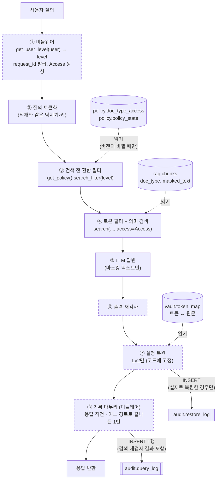
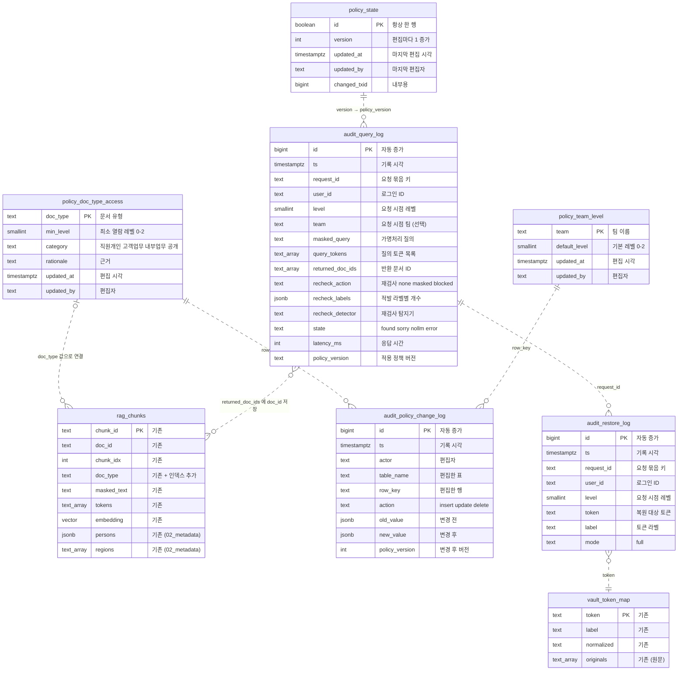
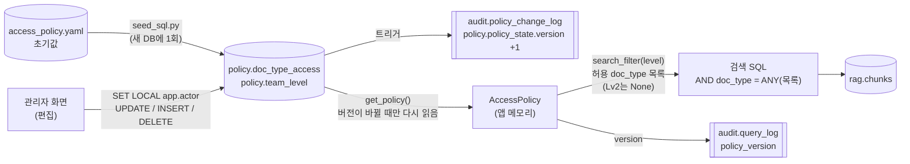

# 권한 정책 데이터 구조 (초안)

2026-11-06 작성 · 2026-11-09 정책 DB 이관 반영
상태: **팀 확정 전 초안**. SQL은 `policy/draft/`에 있고, 아직 `infra/init/`에 넣지 않았습니다.

관련 파일
- 정책서(사람이 읽는 설명, 결정 사항): `docs/permission_policy_draft.md` (9절)
- 감사 로그 스키마: `policy/draft/03_audit_log.sql`
- 정책 테이블 스키마: `policy/draft/04_policy_tables.sql`
- 정책 초기값: `policy/access_policy.yaml` → `python -m policy.seed_sql` → `policy/draft/05_policy_seed.sql`
- 정책 조회 모듈: `policy/access_policy.py` (지금은 YAML을 읽음, DB 읽기는 구현 예정)
- 발표·공유용 그림: `docs/img/permission_db_relation.png`(DB 관계도), `docs/img/permission_flow.png`(흐름도). 원본 HTML은 `docs/img/src/` (브라우저에서 열어 수정)
- 다이어그램 이미지(Mermaid가 안 보이는 환경용): `docs/img/permission_schema_flow.png`, `docs/img/permission_schema_erd.png`, `docs/img/permission_schema_policy_path.png`

## 1. 한눈에 보기

권한 정책 담당으로 설계한 것은 두 가지 스키마입니다.

| 스키마 | 테이블 | 역할 |
|---|---|---|
| `policy` (신규) | `doc_type_access`, `team_level`, `policy_state` | 레벨별로 볼 수 있는 doc_type, 팀별 기본 레벨, 정책 버전. **관리자 화면에서 편집** |
| `audit` (신규) | `query_log`, `restore_log`, `policy_change_log` | 질문(재검사 결과 포함)·복원·정책 변경 기록 (원문 저장 금지) |

테이블 분류

| 분류 | 뜻 | 테이블 |
|---|---|---|
| 마스터 | 업무 기준이 되는 대상의 목록과 속성. 드물게 바뀌고 관리자가 바꿈 | `policy.doc_type_access`(권한 마스터), `policy.team_level` |
| 상태 | 현재 값 하나를 담는 관리용 표 | `policy.policy_state` |
| 이력 | 일이 생길 때마다 계속 쌓이는 표 | `audit.*` 3개 |

레벨(0/1/2) 정의는 편집하지 않으므로 표로 두지 않고, 각 표의 `CHECK (0~2)` 제약과 코드에 고정합니다.

바뀐 점 (2026-11-09, 정책서 9절 결정 3)
- 관리자 화면에서 권한 그룹을 편집하기로 해서, **정책의 원본이 YAML에서 DB 테이블로 바뀌었습니다.**
- `access_policy.yaml`은 새 DB에 처음 한 번 넣는 **초기값(시드)**입니다.
- 화면에서 편집하지 못하게 고정한 것: 레벨 개수(0/1/2), 미등록 doc_type은 Lv2 전용, 실명 복원 규칙(Lv2만 전체 복원). 잘못 바꾸면 개인정보가 바로 노출되는 항목이라 코드에 둡니다.

사용자별 레벨은 로그인 계정 테이블에 저장합니다. 계정 테이블은 로그인 담당 영역이라 이 문서에서는 요구사항만 7절에 적습니다.

## 2. 처리 흐름

질문 하나가 처리될 때 각 테이블이 쓰이는 위치입니다. 점선 상자는 아직 구현되지 않은 단계입니다.



| 단계 | 사용하는 테이블·함수 | 비고 |
|---|---|---|
| ① 미들웨어 | 로그인 계정의 `level` → `get_user_level(user)` | 질문마다 레벨 조회 1회, `request_id` 1개 발급. `Access`(user_id, level, team, request_id, policy_version) 객체를 만들어 이후 단계에 넘김 |
| ③ 권한 필터 | `policy.doc_type_access`, `policy.policy_state` → `get_policy()` | 정책을 캐시해 두고, `policy_state.version`이 바뀌었을 때만 다시 읽음. Lv0/Lv1은 허용 doc_type 목록, Lv2는 필터 없음 |
| ④ 검색 | `rag.chunks` 읽기 | `access`는 **필수 인자**(정책서 9절 결정 4). SQL 세 경로(AND·토큰 없음·boost) 모두에 `AND doc_type = ANY(허용 목록)`을 `LIMIT` 전에 추가. 결과(질의 토큰, 반환 문서)는 메모리에 보관 |
| ⑥ 재검사 | (없음) | 결과(조치, 라벨별 개수, 탐지기)를 메모리에 보관 |
| ⑦ 복원 | `vault.token_map` 읽기, `audit.restore_log` 쓰기 | Lv2만 `full`. **실제로 복원한 경우에만 기록**하며, 기록에 실패하면 복원하지 않음 |
| ⑧ 기록 마무리 | `audit.query_log` 쓰기 | 미들웨어가 응답 직전에 **한 번** 씀(`finally`). 결과 없음·LLM 없음·지역 되묻기·오류로 일찍 끝나도 반드시 1행. 기록에 실패해도 답변은 돌려주고 서버 오류 로그에 남김 |

권한 밖 문서만 있어서 결과가 없을 때도 "일치하는 문서를 찾지 못했습니다"를 그대로 씁니다. "권한 밖 문서 N건 제외" 같은 안내는 하지 않습니다(문서 존재 비노출, 정책서 9절 결정 5).

## 3. ERD

### 3.1 테이블 관계

`PK`는 기본키입니다. 점선은 **외래키 없이 값으로만 연결되는 관계**(논리적 관계)입니다. 이 설계에는 외래키가 없습니다.
- 감사 로그는 원본 데이터가 지워지거나 다시 적재되어도 남아야 하므로 외래키를 걸지 않습니다.
- `rag.chunks.doc_type`과 `policy.doc_type_access`도 외래키로 잇지 않습니다. 정책에 없는 doc_type(신규 템플릿, NULL)도 적재할 수 있어야 하고, 이런 문서는 Lv2 전용으로 처리합니다.



다이어그램 표기 참고: Mermaid에서 배열 타입을 쓸 수 없어 `text[]`를 `text_array`로, 스키마 구분점(`.`)을 `_`로 적었습니다(예: `policy_doc_type_access` = `policy.doc_type_access`). 이전 판의 `rag.person_roles`는 `02_metadata.sql`에서 삭제되어(`rag.chunks.persons`로 대체) 그림에서 뺐습니다.

### 3.2 정책이 쓰이는 경로



- 검색 SQL은 정책 테이블을 JOIN하지 않습니다. 앱이 미리 계산한 **허용 목록을 값으로** 넘깁니다. 정책은 33행뿐이라 앱이 캐시하는 쪽이 단순하고, 검색 SQL의 HNSW 후보 고정 구조도 그대로 유지됩니다.
- Lv2는 필터를 걸지 않으므로 미등록·NULL doc_type 문서도 검색됩니다. 허용 목록만 쓰면 Lv2에서 이 문서들이 빠지므로 `search_filter()`를 써야 합니다.
- 나중에 DB 안에서 직접 판단할 때(RLS 검토, 정책서 9절 결정 6)는 아래 식을 씁니다. 미등록·NULL은 Lv2로 처리합니다.
  `COALESCE((SELECT min_level FROM policy.doc_type_access a WHERE a.doc_type = c.doc_type), 2) <= :level`

## 4. 감사 로그 테이블 (`audit` 스키마, `03_audit_log.sql`)

공통 규칙
- 원문 개인정보는 어떤 컬럼에도 저장하지 않습니다. 질의는 가명처리된 텍스트, 개인정보는 토큰만 기록합니다.
- 앱 계정은 **INSERT만** 할 수 있게 설계했습니다(6절). 그래서 앱에서 `INSERT ... RETURNING`은 쓸 수 없습니다.
- `level`은 요청 시점의 레벨을 복사해 둡니다. 나중에 사용자 레벨이 바뀌어도 당시 판단을 재현할 수 있습니다.
- `user_id`는 로그인 ID 문자열(예: `demo_lv1`)이며, 로그인 테이블과 외래키로 잇지 않습니다.
- `query_log.policy_version`에는 `policy.policy_state.version` 값을 문자열로 적습니다. 그 시점의 정책 내용은 `audit.policy_change_log`를 거슬러 올라가 재현합니다.
- **`request_id`로 한 질문의 로그를 묶습니다.** 미들웨어가 질문마다 번호를 하나 만들어 `query_log`와 `restore_log`에 같은 값을 적습니다. 재검사 결과는 `query_log`의 같은 행에 들어 있습니다. 예를 들어 `demo_lv2`의 질문 하나에 `req-7f3a`가 붙었다면:

  | 테이블 | 기록된 행 |
  |---|---|
  | `query_log` | `req-7f3a` / demo_lv2 / Lv2 / 반환 문서 D0012, D0031 / 재검사 `masked`, `{"phone_number": 1}` |
  | `restore_log` | `req-7f3a` / demo_lv2 / `<PERSON_ab12…>` / full |
  | `restore_log` | `req-7f3a` / demo_lv2 / `<PERSON_c9e0…>` / full |

  `req-7f3a`로 찾으면 "문서 2건 반환, 전화번호 1건 가림, 실명 2명 복원"을 한 번에 재구성할 수 있습니다. 같은 사람이 짧은 간격으로 여러 번 질문해도 어느 복원이 어느 질문에서 나왔는지 구분됩니다.

### 4.1 `audit.query_log` — 조회 로그

근거: 계획서 3절 "평가·감사용 로그에는 가명처리된 질의, 검색 결과, 응답 시간, 재검사 결과만 기록", "출력 재검사 적발 건은 사용자·시각·토큰 단위로 감사 로그에 기록"
기록 시점: 미들웨어가 **응답 직전에 질문마다 1행**. 어느 경로로 끝나든(결과 없음·LLM 없음·지역 되묻기·오류) 반드시 남깁니다.

| 컬럼 | 타입 | NULL | 제약·기본값 | 설명 |
|---|---|---|---|---|
| `id` | BIGINT | N | PK, 자동 증가 | 행 번호 |
| `ts` | TIMESTAMPTZ | N | 기본값 `now()` | 기록 시각 |
| `request_id` | TEXT | N | | `restore_log`와 잇는 키 (질문마다 1개) |
| `user_id` | TEXT | N | | 로그인 ID |
| `level` | SMALLINT | N | 0~2 | 요청 시점의 권한 레벨 |
| `team` | TEXT | Y | | 요청 시점의 소속 팀. 감사 분석과 ABAC 전환 근거 (신규) |
| `masked_query` | TEXT | N | | 가명처리된 질의 (원문 금지) |
| `query_tokens` | TEXT[] | N | 기본값 `{}` | `search()`가 돌려준 질의 토큰 목록 (분석·평가용) |
| `returned_doc_ids` | TEXT[] | N | 기본값 `{}` | 사용자에게 반환한 문서 ID ("권한 밖 문서 노출 0건" 검증용) |
| `recheck_action` | TEXT | Y | `none` / `masked` / `blocked` | 재검사 조치. NULL = 재검사 전에 끝남, `none` = 적발 없음, `masked` = 가림, `blocked` = 답변 차단 |
| `recheck_labels` | JSONB | N | 기본값 `{}`, 객체만 | 적발된 라벨별 개수 (예: `{"phone_number": 1}`). 원문 문자열은 넣지 않음 |
| `recheck_detector` | TEXT | Y | | 재검사에 쓴 탐지기 (예: `koelectra_post_kiwi_split_v3`) |
| `state` | TEXT | Y | `found` / `sorry` / `nollm` / `error` | 응답 상태. 앞의 셋은 `service/app.py`와 같은 값, `error`는 처리 중 오류 |
| `latency_ms` | INT | Y | 0 이상 | 응답 시간(ms) |
| `policy_version` | TEXT | N | | 판단에 사용한 정책 버전 |

인덱스: `ts`, `(user_id, ts)`

제약: `recheck_action`이 `masked`·`blocked`이면 `recheck_labels`에 라벨이 있어야 하고, 그 밖의 경우(`none`, NULL)에는 비어 있어야 합니다.

재검사 적발 건만 보려면 `WHERE recheck_action IN ('masked', 'blocked')`로 거릅니다. (이전 판의 `recheck_log`는 기록 단위가 질문 1건과 같아서 이 표에 합쳤습니다.)

### 4.2 `audit.restore_log` — 실명 복원 로그

근거: 계획서 5절 "실명 복원은 Lv2에서만 허용하며 복원 이력을 감사 로그로 기록"
기록 시점: **복원을 실제로 수행한 경우에만**, 복원한 토큰마다 1행

| 컬럼 | 타입 | NULL | 제약·기본값 | 설명 |
|---|---|---|---|---|
| `id` | BIGINT | N | PK, 자동 증가 | 행 번호 |
| `ts` | TIMESTAMPTZ | N | 기본값 `now()` | 기록 시각 |
| `request_id` | TEXT | N | | 요청 묶음 키 |
| `user_id` | TEXT | N | | 로그인 ID |
| `level` | SMALLINT | N | 0~2 | 요청 시점의 권한 레벨 |
| `token` | TEXT | N | 토큰 형식만 허용 (`<라벨_64자리hex>`) | 복원 대상 토큰. 실명을 넣으면 DB가 거부함 |
| `label` | TEXT | N | | 토큰의 라벨 |
| `mode` | TEXT | N | `full` | 적용된 복원 모드. 부분 복원(`partial`)을 도입하면 값을 추가 |

인덱스: `ts`, `(user_id, ts)`

정책 버전은 남기지 않습니다. 복원 규칙(Lv2만 전체 복원)은 코드에 고정이라 관리자가 편집하는 정책 버전과 관계가 없고, 그 질문의 정책 버전은 `request_id`로 `query_log`에서 확인합니다. `user_id`·`level`은 `query_log`에도 있지만, 복원 기록은 그 행만 봐도 "누가·언제·무엇을" 알 수 있도록 남깁니다.

### 4.3 `audit.policy_change_log` — 정책 변경 이력 (신규, `04_policy_tables.sql`)

근거: 개인정보의 안전성 확보조치 기준 제5조(접근 권한의 변경 기록) 참고
기록 시점: 정책 테이블의 행이 추가·수정·삭제될 때마다 **트리거가** 1행 기록. 앱이 직접 쓰지 않습니다.

| 컬럼 | 타입 | NULL | 제약·기본값 | 설명 |
|---|---|---|---|---|
| `id` | BIGINT | N | PK, 자동 증가 | 행 번호 |
| `ts` | TIMESTAMPTZ | N | 기본값 `now()` | 기록 시각 |
| `actor` | TEXT | N | | 편집한 관리자 ID (`app.actor` 값, 초기값 적재는 `seed`) |
| `table_name` | TEXT | N | | 편집한 표 (예: `policy.doc_type_access`) |
| `row_key` | TEXT | N | | 편집한 행의 키 (예: `회의록`, `인사팀`) |
| `action` | TEXT | N | `insert` / `update` / `delete` | 변경 종류 |
| `old_value` | JSONB | Y | | 변경 전 행 (insert면 NULL) |
| `new_value` | JSONB | Y | | 변경 후 행 (delete면 NULL) |
| `policy_version` | INT | Y | | 변경 후 정책 버전 |

인덱스: `ts`

### 4.4 요청 한 건당 어떤 로그가 쓰이는가

| 상황 | `query_log` | `restore_log` |
|---|---|---|
| Lv0 질문 | 1행 (재검사 결과 포함) | 기록 안 함 (복원 없음) |
| Lv1 질문 | 1행 (재검사 결과 포함) | 기록 안 함 (복원 없음) |
| Lv2 질문 | 1행 (재검사 결과 포함) | 복원한 토큰마다 1행 |
| 결과 없음·지역 되묻기·LLM 없음 | 1행 (`recheck_action` NULL) | 기록 안 함 |
| 처리 중 오류 | 1행 (`state = error`) | 오류 전에 복원했다면 그 행 |

- Lv0·Lv1에서 복원이 차단된 사실은 별도로 기록하지 않습니다. `query_log`의 `level`로 다시 계산할 수 있습니다(복원 규칙은 코드에 고정).
- 기록 순서는 `restore_log`(복원할 때)가 먼저, `query_log`(응답 직전)가 나중입니다. 둘은 `request_id`로 이어지므로 순서는 문제가 되지 않습니다.
- Lv2에서 복원이 일어나지 않은 경우(예: 재검사에서 답변 차단)는 `query_log.recheck_action = blocked`나 `state`로 구분합니다.

## 5. 정책 테이블 (`policy` 스키마, `04_policy_tables.sql`)

### 5.1 `policy.policy_state` — 정책 버전 (상태 테이블, 한 행)

| 컬럼 | 타입 | NULL | 제약·기본값 | 설명 |
|---|---|---|---|---|
| `id` | BOOLEAN | N | PK, 항상 `true` | 표에 행이 하나만 있도록 보장 |
| `version` | INT | N | 0 이상, 기본값 0 | 정책 버전. 편집을 저장할 때마다 1 증가 (초기값 적재 후 1) |
| `updated_at` | TIMESTAMPTZ | N | 기본값 `now()` | 마지막 편집 시각 |
| `updated_by` | TEXT | Y | | 마지막 편집자 |
| `changed_txid` | BIGINT | Y | | 내부용. 한 번 저장(트랜잭션)에 버전이 두 번 오르지 않게 함 |

앱은 `version`만 자주 읽고, 캐시한 값과 다를 때만 `doc_type_access`를 다시 읽습니다.

### 5.2 `policy.doc_type_access` — doc_type별 최소 레벨 (권한 마스터, 편집 가능)

| 컬럼 | 타입 | NULL | 제약·기본값 | 설명 |
|---|---|---|---|---|
| `doc_type` | TEXT | N | PK, 앞뒤 공백·빈 문자열 금지 | 문서 유형 (화면에서 이름 변경 불가) |
| `min_level` | SMALLINT | N | 0~2 | 이 유형을 볼 수 있는 최소 레벨 |
| `category` | TEXT | N | `직원개인` / `고객업무` / `내부업무` / `공개` | 정책서 3절 판정 질문의 결과(어떤 종류의 문서인가). 기존 행에서는 수정 불가 |
| `rationale` | TEXT | N | | 판정 근거 (계획서와 다른 경우 여기에 적음) |
| `updated_at` | TIMESTAMPTZ | N | 트리거가 채움 | 편집 시각 |
| `updated_by` | TEXT | N | 트리거가 채움 | 편집자 |

- 분류(`category`)와 기본 레벨

  | 분류 | 판정 질문 | 기본 레벨 | 행 수 |
  |---|---|---|---|
  | 직원개인 | 2 | Lv2 | 4 |
  | 고객업무 | 3 | Lv1 | 18 |
  | 내부업무 | 4 | Lv1 | 7 |
  | 공개 | 5 | Lv0 | 4 |

  판정 질문 1(미등록)은 행이 없는 경우라 분류 값이 없고 Lv2로 처리합니다. 순서(위에서부터 처음 해당하는 질문)는 사람이 분류할 때의 절차이며, DB에는 결과만 저장합니다.
- 안전장치(CHECK `doc_type_access_level_floor`): `min_level`은 분류의 기본 레벨 이상이어야 합니다. **올리기만 가능하고 내릴 수는 없습니다.** 직원 개인 문서는 항상 Lv2이고, 고객업무·내부업무는 Lv0으로 내릴 수 없습니다. 같은 규칙을 `load_policy()`(초기값 YAML 검증)도 적용합니다(정책서 9절 결정 8).
- 기존 행의 `doc_type`(이름)과 `category`는 수정할 수 없습니다(트리거). 분류를 바꿔 위 안전장치를 피하는 실수를 막기 위함입니다. 분류가 잘못되었다면 행을 삭제한 뒤 올바른 분류로 다시 추가하며, 삭제와 추가는 모두 변경 이력에 남습니다. 이 장치는 **실수 방지**이고, 관리자가 의도적으로 삭제 후 다른 분류로 다시 넣는 것까지 막지는 못합니다. 그 경우는 변경 이력으로 추적합니다.
- 행을 지우면 그 유형은 미등록이 되어 Lv2 전용으로 바뀝니다. 지워도 노출 범위가 넓어지지 않습니다.
- 정책에 없는 유형의 기본값(Lv2)은 이 표에 두지 않고 코드에 고정합니다.
- 마스터이지만 `rag.chunks.doc_type`이 외래키로 참조하지는 않습니다. 정책에 없는 새 유형도 적재되어야 하기 때문입니다(값으로만 연결).
- doc_type 하나에 규칙이 하나뿐이라 "문서 유형 목록"과 "권한 규칙"을 한 표로 합쳤습니다. 같은 유형에 조건이 여러 개 붙게 되면(예: 팀별 예외) 나눕니다.

### 5.3 `policy.team_level` — 팀별 기본 레벨 (팀 마스터, 편집 가능)

| 컬럼 | 타입 | NULL | 제약·기본값 | 설명 |
|---|---|---|---|---|
| `team` | TEXT | N | PK, 앞뒤 공백·빈 문자열 금지 | 팀 이름 (직원 목록과 같은 표기) |
| `default_level` | SMALLINT | N | 0~2 | 이 팀 계정을 만들 때 채우는 기본 레벨 |
| `updated_at` | TIMESTAMPTZ | N | 트리거가 채움 | 편집 시각 |
| `updated_by` | TEXT | N | 트리거가 채움 | 편집자 |

- 계정을 만들 때만 씁니다. **검색은 계정의 `level`만 봅니다.** 그래서 이 표를 고쳐도 기존 사용자의 레벨은 바뀌지 않습니다(권한이 의도치 않게 넓어지는 것 방지).
- 표에 없는 팀은 Lv0입니다(코드에 고정, `default_level_for_team()`).

### 5.4 편집 규칙 (트리거)

`doc_type_access`, `team_level`을 편집하면 트리거 `policy.record_change()`가 다음을 처리합니다.

| 처리 | 내용 |
|---|---|
| 편집자 확인 | 같은 트랜잭션에 `SET LOCAL app.actor = '<관리자 ID>'`가 없으면 **편집 거부**. 변경 이력 없이 정책을 바꿀 수 없게 함 |
| 편집 시각·편집자 | `updated_at`, `updated_by`를 DB가 채움. 앱이 다른 값을 넣어도 덮어씀 |
| 버전 증가 | `policy_state.version` +1. 한 트랜잭션(저장 1회)에서 여러 행을 고쳐도 1만 증가 |
| 변경 이력 | `audit.policy_change_log`에 변경 전후 값 기록 |
| 이름·분류 보호 | `doc_type_access`의 `doc_type`, `category`는 수정 거부 (별도 트리거 `policy.guard_doc_type_access()`) |
| 전체 삭제 차단 | `TRUNCATE`는 트리거를 거치지 않으므로 막음 |

관리자 화면 API의 저장 예시:

```sql
BEGIN;
SET LOCAL app.actor = 'admin01';
UPDATE policy.doc_type_access SET min_level = 2, rationale = '...' WHERE doc_type = '회의록';
UPDATE policy.team_level SET default_level = 1 WHERE team = 'IT운영팀';
COMMIT;   -- 버전 1 증가, 변경 이력 2행
```

로그인 계정 테이블의 레벨 변경(WBS 3.3.3)에도 같은 트리거 함수를 붙이면 레벨 변경 이력이 같은 표에 남습니다(키 컬럼 `user_id`, 버전은 올리지 않음).

## 6. 계정별 권한 설계 (적용은 WBS 3.4.1 구현 단계)

지금은 스키마 설계까지가 범위라 **계정과 권한은 만들지 않았습니다.** `04_policy_tables.sql`에는 계정 생성·GRANT가 없고, `03_audit_log.sql`의 GRANT는 이전에 검증한 감사 로그 권한입니다. 구현할 때 아래 표를 기준으로 적용합니다.

| 대상 | `rag_user` (검색) | `vault_user` (복원) | 관리자 화면 계정 (신규) | `audit_reader` (감사 조회, 신규) | DB 관리자 |
|---|---|---|---|---|---|
| `audit.query_log` | INSERT | - | - | SELECT | 전체 |
| `audit.restore_log` | - | INSERT | - | SELECT | 전체 |
| `audit.policy_change_log` | - | - | SELECT (트리거가 기록) | SELECT | 전체 |
| `policy.policy_state`, `doc_type_access` | SELECT | - | SELECT, `doc_type_access` 편집(키 제외) | - | 전체 |
| `policy.team_level` | - | - | SELECT, 편집(키 제외) | - | 전체 |
| `rag.*`, `vault.*` (기존) | `rag.*` 전체 | `vault.*` 전체 | - | - | 전체 |

- 관리자 화면 계정은 검색 데이터, 실명 매핑, 조회·복원 로그에 접근하지 않습니다. 권한 편집자와 실명 열람자를 분리하기 위함입니다.
- 트리거 함수는 함수를 만든 관리자 권한으로 실행됩니다(`SECURITY DEFINER`). 그래서 관리자 화면 계정에 변경 이력·버전 표 쓰기 권한을 주지 않아도 기록됩니다.
- DB 관리자와 서버(EC2) 관리자는 앱 권한 밖이며, 이들의 접근은 앱 감사 로그에 남지 않는다는 한계가 있습니다(정책서 8절).
- 감사 로그는 읽기 전용 계정 `audit_reader`로만 읽습니다(정책서 9절 결정 10). 복원 이력 조회(WBS 4.2), 관리자 화면의 변경 이력(3.3.4), 이상 접근 탐지(7.2), 평가 리포트(9.1)가 이 계정을 씁니다. DB 계정은 읽기만 허용하고, **화면에서 누가 볼지는 앱이 정합니다**(정책 변경 이력 = `is_admin` 계정, 조회·복원 로그 = Lv2). 적용 시 `03_audit_log.sql`의 권한 부분에 `GRANT USAGE ON SCHEMA audit` 과 `GRANT SELECT ON ALL TABLES IN SCHEMA audit TO audit_reader` 를 추가합니다.
- vault 접근은 **실명 복원만** 토큰 단위로 기록합니다(`restore_log`, 결정 11). 적재 단계(`ingest.py`)의 vault 쓰기는 사용자에게 실명이 보이지 않으므로 감사 대상이 아니며, 실행 단위(실행자·시각·건수)만 스크립트 출력으로 남깁니다.

## 7. 다른 담당 영역에 대한 요구사항

| 데이터 | 상태 | 필요 시점 |
|---|---|---|
| 로그인 계정 (`auth.users` 등) | 요구사항 정의됨, 테이블은 로그인 담당이 설계 | 미들웨어 연결 전 (그동안은 시연 계정 3개를 임시 표로 사용) |
| 직원 목록 (ID·팀·직급) | 미설계 | 팀 대응표 확정 시 |
| 문서 메타 (`doc_meta`: 담당 팀·직원) | 미설계 | 2차 기준 도입 시 |

로그인 계정 요구사항
- `level`: 0~2, 필수. 권한 판단의 기준값. 계정을 만들 때 `policy.team_level`로 기본값을 채우고, 관리자가 사용자별로 바꿀 수 있음
- `team`: 선택. `policy.team_level`과 같은 표기를 사용
- `is_admin`: 필수(기본 false). 관리자 화면 접근 여부. **레벨과 별개**이며 Lv0~2 어느 계정에도 붙일 수 있음(정책서 9절 결정 9). 시연용 관리자 계정 1개 추가
- 레벨은 `get_user_level(user)` 함수 하나로만 가져옴
- 레벨 부여에 직급은 사용하지 않음(정책서 7.1절)
- 레벨 변경 이력: 5.4절의 트리거를 붙이는 방식 권장

관리자 화면 요구사항
- 접근: 로그인 계정의 `is_admin = true`인 경우만. DB 연결은 관리자 화면 계정(편집), 이력 조회는 `audit_reader`
- 저장할 때마다 같은 트랜잭션 안에서 `SET LOCAL app.actor = '<로그인한 관리자 ID>'` 실행 (없으면 DB가 거부)
- 편집 가능: `doc_type_access`(최소 레벨·근거), `team_level`(기본 레벨), 사용자별 레벨. 새 doc_type을 추가할 때는 분류를 4개 중 선택(드롭다운)
- 편집 불가: 레벨 개수, 미등록 doc_type 기본값, 복원 규칙, 기존 doc_type의 이름·분류, 팀 이름(키)
- 레벨 하한: doc_type 최소 레벨은 분류 기본 레벨 아래로 내릴 수 없음(DB가 거부). 화면의 선택지도 하한 이상만 보여 주면 오류 메시지를 줄일 수 있음
- 변경 이력 조회 화면(WBS 3.3.4)은 `audit.policy_change_log`를 읽음

직원 목록 요청 사항: 팀 이름 표기를 하나로 통일하고, "고객센터"의 조직명과 대표 연락처 표기를 구분.

## 8. 초기값 파일 구조 (`policy/access_policy.yaml`)

운영 중 원본은 DB이고, 이 파일은 새 DB에 처음 넣는 값입니다. `05_policy_seed.sql`은 **표가 비어 있을 때만** 넣으므로, 다시 실행해도 관리자가 편집한 값을 덮어쓰지 않습니다.

| 항목 | 형식 | DB 대응 |
|---|---|---|
| `version`, `updated`, `status` | 문자열 | 초기값 이름 (DB 버전은 적재 후 1부터 시작) |
| `levels` | 레벨 → {`name`, `description`} | DB 표 없음. 코드·문서에 고정 (DB는 `CHECK 0~2`) |
| `defaults.unregistered_min_level` | 2 | 코드에 고정 |
| `doc_types` | doc_type → {`min_level`, `category`, `rationale`} | `policy.doc_type_access` (33행) |
| `team_default_levels` | 팀 → 기본 레벨 | `policy.team_level` (10행) |
| `restore` | 레벨 → 라벨 → `none`/`full` | 코드에 고정 |
| `audit_log_read_min_level` | 2 | 코드에 고정 |

조회 함수 (`policy/access_policy.py`)

| 함수 | 반환 | 용도 |
|---|---|---|
| `search_filter(level)` | 허용 doc_type 목록 또는 `None` | **검색 필터에는 이 함수를 사용.** Lv2는 `None`(필터 없음) |
| `can_view(level, doc_type)` | bool | 문서 하나의 열람 가능 여부 |
| `restore_mode(level, label)` | `none` / `full` | 복원 여부 |
| `can_read_audit_log(level)` | bool | 감사 로그 확인 가능 여부 |
| `default_level_for_team(team)` | 0~2 | 계정을 만들 때 채울 기본 레벨. 표에 없으면 0 |
| `allowed_doc_types(level)` | 등록된 doc_type 목록 | 참고용. 미등록 유형이 빠지므로 검색 필터에는 쓰지 않음 |

구현 예정: DB에서 정책을 읽는 `get_policy()`(버전 확인 캐시), `Access` 객체, 검색 함수의 필수 인자 `access`.
