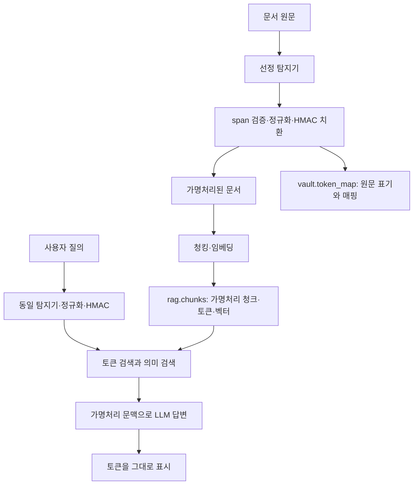

# 실전 2 가명처리·검색 개발 전 설계서

작성: 2026-10-29 · 상태: **개발 전 제안 v0.1 / 팀 승인 전**

이 문서는 시작 키트의 데모 실행에서 확인한 사실, 구현 전에 합의할 기준, 검증 및 보고 계획을 관리한다. 아래의 제안은 구현 완료나 팀 합의를 뜻하지 않는다. 실제 비밀키·비밀번호·원문 데이터를 기록하지 않는다.

## 1. 목표와 범위

목표는 실전 1에서 선정한 탐지기의 출력으로 문서와 질의를 동일하게 가명처리하고, 실명이 없는 검색 데이터로도 대상 문서를 찾는 기본형을 만드는 것이다. 검색된 가명처리 문맥으로 답변하며 토큰은 그대로 표시한다.

| 이번 단계에 포함 | 종합 단계에서 다룰 기능 |
|---|---|
| 선정 탐지기 연결, 값 정규화, HMAC 결정적 토큰, 매핑 저장 | 실명 복원 및 사용자 권한에 따른 제공 |
| 가명처리 후 청킹·임베딩·적재, 질의 토큰화 | 동명이인에 대한 실제 인물 식별 |
| 토큰과 의미 검색 결합, 기본 답변·시연 | 검수와 출력 보호의 운영 체계 |
| 이름 토큰 일관성 및 검색 질의 **88개** 평가 | 운영 배포·완전한 개인정보 보호 보증 |

`split_v3` 앙상블은 내부에서 여러 모델과 규칙을 사용하지만 파이프라인에는 하나의 선정 탐지기로 연결한다. 이름 문자열이 같은 서로 다른 사람은 같은 토큰이 되는 한계를 인정한다. 정답 인물 ID로 이를 보정하지 않는다.

## 2. 현재 확인한 상태와 실행 근거

기준 Git HEAD: `da5adb4` (`add: develop 변경 사항(초기 세팅) 병합`). 실행 시 작업 트리의 설정 변경도 있으므로 이 커밋만으로 실행 환경이 완전히 고정됐다고 보지 않는다.

| 항목 | 확인한 사실 | 해석 |
|---|---|---|
| 사용자 적재 실행 | 187문서 → 187청크, 토큰 2종, `EMBED_PROVIDER=local` | 데모 적재 흐름 동작 |
| 예측 파일 확인 | `outputs/pseudo_holdout_labeled.jsonl` 187행, 전화 87구간·이메일 43구간, 고유 토큰 2종 | 사람 이름 토큰 없음. 130구간 수는 정답 탐지율이 아님 |
| 토큰 충돌 경고 | `<EMAIL_1>`, `<PHONE_NUMBER_1>`의 서로 다른 값이 같은 토큰 사용 | 문서별 순번 토큰을 재사용하는 데모 설계 문제. HMAC 충돌 실험 결과가 아님 |
| 단일 검색 실행 | 전화 질의와 관련 문서 목록 출력 | 검색 호출 성공. 해당 번호의 정답 문서를 찾았다는 근거는 아님 |
| 답변 실행 | `LLM_API_KEY` 없음 → 검색 결과만 표시 | LLM 답변 생성·품질 검증은 미실행 |
| 일괄 검색 | 기본 질의 파일 경로 오류로 실패, `outputs/run_v1.jsonl` 없음 | 88개 질의 점수는 아직 없음 |
| 데모 상태 | `starter/pii_pipeline.py`의 `IS_DEMO=True` | 최종 제출용 가명처리 모듈 미구현 |

현재 데모는 이름·주소·계좌 등 원문을 남긴다. 따라서 현 DB를 완전히 가명처리된 검색 데이터라고 부르지 않는다. 개선 후에는 기존 데모 청크를 남기지 않고 새 버전으로 전체 재적재해야 한다. 가상 데이터로 로컬 동작만 확인했으며, 이 결과를 외부 API 전송의 안전성이나 최종 성능으로 해석하지 않는다.

### 구현 전에 정리할 실제 장애

1. `detection/combo.py`에 병합 충돌 표시가 남아 있어 선정 탐지기를 import할 수 없다. 이전 수정의 보관 상태를 확인해 복구하고 기본 추론을 다시 확인한다. 과거 테스트 56개 통과 기록을 현재 코드의 통과 결과로 쓰지 않는다.
2. 질의·정답 파일은 `data/holdout/` 아래에 있다. 키트 기본 경로 `data/`와 달라 명시적인 경로 인자가 필요하다.
3. 저장소에 `eval/eval_holdout_retrieval.py`가 없다. 받은 키트에는 있으며, 공유 시 원본 평가기를 가져와야 한다. `.gitignore`의 `*holdout*` 규칙은 이 스크립트 이름에도 영향을 줄 수 있으므로 코드 공유 경로를 확인한다.
4. `requirements.txt`의 NumPy 1.26.4 고정과 현재 Python 3.13 환경의 호환성을 정리한다. 시스템 Python에 강제 설치하지 않고 검증한 가상환경의 의존성을 기록한다.

## 3. 파이프라인과 파일별 책임



| 파일 | 책임 / 개발 범위 |
|---|---|
| `starter/pii_pipeline.py` | 팀 구현: `detect()` 연결, `pseudonymize()`의 정규화·결정적 토큰·원문 위치 보존 |
| `starter/ingest.py` | 기존 흐름 활용: 문서 전체 가명처리 후 청킹·임베딩, 청크와 원문 표기 배열 저장 |
| `starter/search.py` | 팀 구현: 질의 가명처리 후 토큰과 의미 검색의 결합 방식 |
| `starter/embed.py` | 우선 제공 코드 활용. 로컬 해시 임베딩은 동작 확인용이며 학습된 의미 임베딩과 구분 |
| `starter/chat.py` | 기본 답변 코드 활용. API 키가 없으면 검색 결과만 반환 |
| `starter/run_queries.py` | 질의별 검색 결과 생성. 설계별 새 파일명 사용 |
| `eval/check_token_consistency.py` | 원본 채점기 유지. person 기준 일관성·실패 사례 분석 |
| 키트 검색 채점기 | 원본 채점기 유지. 전체·유형별 Hit@k, Recall@k, MRR, Confuse@k |

## 4. 구현 전 결정 기록

실무 방식은 알고리즘 이름만 정하는 것이 아니라 **적용 범위·실패 동작·검증 예제·변경 버전**을 함께 정하는 것이다. 아래 기준은 이번 기본형을 위한 제안이며 보편적 산업 의무 규정으로 설명하지 않는다.

| 결정 | 제안 | 상태 |
|---|---|---|
| 탐지기 | `koelectra_post_kiwi_split_v3`를 한 번 로드해 문서·질의 모두 호출 | 사용자 선정 방향. 실제 연결 전 |
| 연결 기준 | 개인 식별이 아닌 `라벨 + 정규화된 문자열` 동일성 | 과제 기본형 범위 |
| 문자 처리 | 추출 값 사본에 NFC와 앞뒤 공백 정리. 원문 전체는 변경하지 않음 | 팀 검토 제안 |
| 이름 | 한글과 공백으로 된 이름 span은 내부 공백 제거. 외국인 이름은 내부 공백 축약, 대소문자·하이픈 보존 | 팀 검토 제안 |
| 부분 이름 | `선영`을 `윤선영`으로 추측 연결하지 않음. 성씨 사전·인물 ID로 보완하지 않음 | 팀 검토 제안 |
| 토큰 계산 | HMAC-SHA256, 초기 버전은 전체 64자리 16진수 사용 | 팀 검토 제안 |
| 키 | 무작위 32바이트를 64자리 hex로 보관. hex를 32바이트로 해석하는 방법을 문서·질의 공통으로 고정 | 팀 검토 제안 |
| 키가 비어 있거나 형식이 틀림 | 처리 중단. 기본값·빈 키·임의 순번으로 대체하지 않음 | 개발 승인 기준 제안 |
| 범위·겹침 오류 | 진단을 남기고 처리 중단. 개인정보 구간을 조용히 버리지 않음 | 개발 승인 기준 제안 |
| 범위 밖 라벨 | v3의 `driver_license` 등 추가 라벨 처리 범위는 명시적 합의 필요. 미지원 라벨을 원문으로 조용히 통과시키지 않음 | 미결정 |
| 검색 기본안 | 의미 검색 기준선과 토큰 우선 검색안을 분리 비교 | 팀 검토 제안 |
| 정량 목표 | 기능 불변조건은 6절, 검색 성능 목표와 허용 지연은 기준선 확인 후 정함 | 수치 목표 미결정 |

NFC는 정준적으로 같은 문자의 표현을 통일한다. NFKC는 더 많은 표현 차이를 제거하므로 모든 값에 무조건 적용하지 않는 안을 택한다. 이는 Unicode 정규화 특성에 근거한 프로젝트 설계 선택이다. [Unicode UAX #15](https://unicode.org/reports/tr15/)

### 라벨별 정규화 제안

| 대상 | 같은 값으로 묶을 예 | 보존하거나 별도 결정할 차이 |
|---|---|---|
| 한글 이름 | `윤 선영` / `윤선영` | `선영` / `윤선영`은 별도. 이름 끝 `이·아·은`을 일괄 삭제하지 않음 |
| 외국인 이름 | 앞뒤 공백 및 반복 공백 | 이름 순서·대소문자·하이픈은 우선 보존 |
| 전화 | `010-1234-5678` / `010 1234 5678` | `+82 10…` / `010…` 변환과 내선 처리는 별도 규칙 필요 |
| 계좌·카드·주민번호 | 탐지된 값 안의 허용한 공백·하이픈 등 구분자 차이 | OCR 문자나 모든 비숫자를 임의 삭제하지 않음. 은행명이 없는 계좌의 기관 간 중복은 문자열 기준 한계 |
| 이메일 | 도메인 대소문자, 앞뒤 공백 | 로컬 파트는 대소문자 보존. 점 제거·`+태그` 삭제 등 공급자별 추측 금지 |
| 주소 | 앞뒤 공백·반복 공백 | `서울` / `서울특별시`, 건물명 생략, 상세주소는 임의 통합하지 않음 |

이메일 로컬 파트는 대소문자를 보존하는 기본안을 택한다. 도메인은 대소문자를 구분하지 않지만 로컬 파트는 구분할 수 있다. [RFC 5321 §2.4](https://www.rfc-editor.org/rfc/rfc5321#section-2.4)

### 토큰과 키의 구체적 약속

- 입력은 규칙 버전·라벨·정규화 값을 담은 고정 형식의 UTF-8 직렬화로 통일한다. 예: 세 문자열의 JSON 배열, 고정 구분자 설정. 단순 문자열 붙이기로 필드 경계가 모호해지지 않게 한다.
- 표시는 `<PERSON_64자리hex>`, `<PHONE_NUMBER_64자리hex>`와 같이 키트 `TOKEN_PATTERN`에 맞춘다. 긴 토큰의 임베딩·LLM 입력 비용은 한계로 기록하며 길이 축약은 별도 변경으로 검증한다.
- 현재 환경은 프로젝트 루트 `.env`의 `HMAC_KEY`를 사용한다. 원격 운영에서는 비밀 관리 저장소 사용을 검토한다. 사용자 입력이나 요청마다 키를 새로 만들지 않는다.
- 기록에는 `key_id`와 규칙 버전만 남긴다. 실제 키·키를 직접 유추할 수 있는 값을 로그나 보고서에 쓰지 않는다.
- 동일 토큰에 서로 다른 `(label, normalized)`가 연결되면 저장을 중단하고 원인을 조사한다. 동일 정규화 값에 여러 원문 표기가 대응하는 것은 정상이다.
- 키·정규화·토큰 입력 규칙을 바꾸면 기존 토큰과 호환되지 않을 수 있다. 실전 2는 버전별로 전체 재적재하고 질의도 같은 버전을 사용한다. 운영에서는 별도 마이그레이션 계획이 필요하다.

HMAC은 비밀키와 해시 함수를 사용하는 계산 방식이다. 이 설계의 SHA-256 선택과 토큰 형식은 프로젝트 결정이며, 키의 무작위 생성은 HMAC 문헌의 권고에 근거한다. 토큰은 암호문 복호화로 원문을 되찾는 방식이 아니며, 결정적 토큰만으로 익명성이 보장되지는 않는다. [RFC 2104](https://www.rfc-editor.org/info/rfc2104/)

## 5. 함수·데이터·접근 권한 계약

| 경계 | 반드시 유지할 약속 |
|---|---|
| `detect(text)` | `[{label, start, end}, …]`. 원문 기준 `[start,end)`. 인물 ID와 정답 라벨 입력 금지 |
| `pseudonymize(text, spans)` | `(masked_text, records)`. records는 `label/start/end/original/normalized/token` 포함 |
| span 검증 | `0 ≤ start < end ≤ 원문 길이`, 비중첩, 추출 값과 원문 슬라이스 일치. 정규화로 원문 위치를 다시 계산하지 않음 |
| 원문 표기 매핑 | `vault.token_map.originals` 배열에 같은 값의 표기들을 모음. 키트는 단일 `original` 컬럼 구조가 아님 |
| 청킹 | 문서 전체를 가명처리한 뒤 수행. 토큰 중간을 자르지 않음 |
| 임베딩·LLM 경계 | 가명처리가 끝난 텍스트만 전달. 탐지 미탐 가능성은 별도로 측정하며 함수 이름만으로 안전하다고 단정하지 않음 |
| 검색 | `rag_user`만 사용. `vault`를 읽어 원문으로 검색하거나 복원하지 않음 |
| 적재 매핑 저장 | `vault_user` 사용. 키·원문 값은 일반 로그와 결과 공유물에서 제외 |

계정이 분리돼 있어도 가명처리·적재 프로세스는 두 계정 정보를 가질 수 있다. 검색 코드가 실제로 사용하는 연결과 운영 자격 증명의 분리도 확인해야 한다. 초기화 SQL에 권한 설정이 있다는 이유만으로 실행 환경의 권한 검증을 생략하지 않는다.

기본형은 의도적인 동명이인 합쳐짐, 부분 이름의 쪼개짐, 탐지 미탐이 남을 수 있다. 토큰은 동등한 값의 연결 정보도 노출하므로 이를 완전한 익명화라고 표현하지 않는다. 외부 전송 전에는 로컬 결과 검토를 하고, 불확실하거나 실패한 처리를 원문 그대로 재시도하지 않는 동작을 정한다. [NIST SP 800-188](https://csrc.nist.gov/pubs/sp/800/188/final)은 식별 제거를 위험 감소와 유용성의 관점에서 평가하도록 설명한다.

## 6. 개발 승인 전에 확인할 예제와 통과 조건

아래 조건은 작은 합성 예제로 확인하는 기능 기준이다. 문서 전체에서의 미탐 0이나 검색 성능 100%를 이미 달성했다는 의미가 아니다.

| 확인 항목 | 통과 조건 |
|---|---|
| 결정성 | 같은 키·버전·라벨·정규화 값은 호출 순서, 문서 ID, 실행 프로세스가 달라도 동일 토큰 |
| 구별성 | 같은 이름의 다른 사람을 제외하고, 다른 정규화 값이 같은 토큰이 되는 사례 0건 |
| 동일 표기 변형 | 문서 `윤 선영`과 질의 `윤선영`은 동일 토큰 |
| 부분 이름 | `선영`과 `윤선영`을 자동으로 같은 사람으로 합치지 않음 |
| 이름 보호 | `권온유이` 등 경계 문제를 정규화가 임의 글자 삭제로 은폐하지 않음. 탐지·후처리 오류로 기록 |
| 라벨 분리 | 같은 문자열이라도 다른 라벨이면 다른 토큰 |
| 원문 위치 | 토큰 길이가 달라도 records의 시작·끝은 원문 기준 유지 |
| 오류 동작 | 빈 키·잘못된 위치·중첩·미지원 라벨은 규정한 오류 처리. 원문 그대로 API 전송 금지 |
| 저장·조회 | 같은 정규화 값의 원문 표기를 배열로 보존. 검색 계정의 vault 조회는 거부 |
| 실제 경로 | 질의 파일 88행 전체의 고유 qid가 출력에 한 번씩 존재. 데이터·출력 파일을 서로 구분 |

## 7. 검색안과 비교 실험

첫 비교안은 단순하게 둔다. 아직 검색 성능을 확인하지 않았으므로 가중치·우선순위를 최적이라고 확정하지 않는다.

| 실험 | 구성 | 확인할 질문 |
|---|---|---|
| D0 데모 진단 | 현재 순번 토큰 + 데모 탐지 + 로컬 임베딩 | 파이프라인이 연결됐는가? 데모 충돌·원문 잔존은 무엇인가? |
| P1 가명처리 기준선 | 선정 탐지기 + 결정적 HMAC + 이름 공백 통합 전 | 순번 충돌이 사라졌는가? 이름 표기 차이로 얼마나 쪼개지는가? |
| P2 정규화 적용 | P1과 **동일 탐지 결과**에 4절 정규화 적용 | 정규화 자체가 쪼개짐·잘못 합쳐짐에 미치는 영향은? |
| S1 의미 검색 | P2 적재 데이터 + 의미 검색만 | 새 가명처리 데이터의 검색 기준선은? |
| S2 토큰 우선 | P2와 동일 데이터·벡터에서 토큰 일치 후보 우선, 각 그룹은 의미 점수로 정렬 | 개인정보가 들어 있는 질의의 정답·혼동 문서 비율이 어떻게 바뀌는가? |

S2의 구체안: 질의 토큰이 없으면 S1을 사용한다. 하나면 그 토큰이 있는 후보를 우선하고, 여러 개면 모두 일치 → 일부 일치 → 미일치 순으로 그룹을 나눈다. 후보가 부족하면 의미 검색으로 보충하되, 토큰 일치 결과가 없는 경우를 기록한다. 이는 엄격한 필터에서 생길 수 있는 누락을 비교하려는 제안이며 구현·합의 전이다. 후보가 적은 실전 2에서는 문서별 중복 제거 후 k개가 모이는지도 확인한다.

키트의 현재 `k*3`개 청크 조회는 문서별 중복 제거 후 k개 문서를 보장하지 않는다. 검색 완료 기준에는 중복 문서가 순위를 독점하지 않는지와 후보 부족 동작을 포함한다. 보충 검색이 동명이인 혼동을 늘릴 수 있으므로 Recall과 Confuse를 함께 본다.

일관성 평가는 키트 정의에 따라 사람 이름의 미탐 횟수, 쪼개진 인물 수, 합쳐진 토큰 수를 별도 분모로 보고한다. 단순 겹침으로 연결하는 키트 채점 결과와 strict 경계 정확도는 구분한다. 동명이인 합쳐짐과 다른 이름의 잘못 합쳐짐도 나눈다.

검색 평가는 전체 및 질의 유형별 Hit@1/5, Recall@5/10, MRR, Confuse@10과 실행 시간을 기록한다. 로컬 해시 임베딩 결과와 학습된 임베딩 API 결과는 다른 실험으로 표시한다. 챗봇은 검색 근거 문서 ID·답변의 근거 충실성·토큰 유지 여부를 시연한다. LLM을 연결하기 전 검색 성공만으로 답변 품질을 주장하지 않는다.

Holdout 문서 187개와 평가 질의 88개는 이미 열람·실행 대상으로 사용했다. 향후 결과를 독립적인 미열람 일반화 평가라고 부르지 않는다. 규칙은 우선 dev·별도 합성 짝 문장으로 검증하고, 평가 자료를 보며 수정한 경우 해당 이력을 기록한다. 인물 ID·질의 정답은 채점에만 사용하며 검색 후보 생성·토큰 생성에 넣지 않는다.

## 8. 실행·결과 보존 규칙

명령은 프로젝트 루트에서 `.venv`를 활성화한 뒤 실행한다. 현재 단계에서는 파일 경로 오류만 바로잡은 **데모 진단**으로 실행하며 외부 API는 호출하지 않는다.

```bash
source .venv/bin/activate
EMBED_PROVIDER=local python -m starter.run_queries --queries data/holdout/holdout_retrieval_queries.jsonl --out outputs/run_demo_local_20261029.jsonl
python eval/check_token_consistency.py --gold data/holdout/holdout_persons_gold.jsonl --pred outputs/pseudo_holdout_labeled.jsonl --out outputs/token_consistency_demo_local_20261029.csv
```

위 명령은 본 문서 작성 중 실행하지 않았다. 이 일관성 결과는 데모의 이름 미탐 확인용이지 최종 모듈 결과가 아니다. 이름 미탐이 많으면 쪼개짐이 작아 보여도 좋은 결과로 해석하지 않는다.

키트의 원본 검색 평가 스크립트를 저장소 `eval/`에 확보한 **뒤** 실행할 명령:

```bash
python eval/eval_holdout_retrieval.py --gold data/holdout/holdout_retrieval_queries_gold.jsonl --run outputs/run_demo_local_20261029.jsonl
```

`ingest.py`는 동일 입력명에 대해 `outputs/pseudo_holdout_labeled.jsonl`을 덮어쓰므로 새 적재 전 현재 파일을 실험별 폴더에 보존한다. `run_queries.py`도 기존 `--out`을 덮어쓸 수 있으므로 새 실험명을 쓴다. `--reset`은 청크·토큰 매핑을 비우므로 결과 보존 후 의도한 재적재 시에만 사용한다. DB 볼륨 삭제는 모듈·정규화 변경의 일반적인 재평가 절차로 사용하지 않는다.

실험별로 다음 메타데이터를 보존한다: 실행 시각, Git 커밋과 작업 트리 변경, 소스·코퍼스·질의·예측 파일 SHA-256, 탐지기·모델 파일 버전, `VEIL_FULL` 설정, 정규화·토큰 규칙 버전, key_id, 임베딩 방식·모델·차원, 청킹 설정, 검색안·k, 장비·패키지 버전, 예측·채점 경로. 실제 키와 API 자격 증명은 제외한다. 키트의 두 DB 쓰기는 별도 트랜잭션이므로 중간 실패 시 청크·매핑이 일부만 갱신될 수 있다. 재시도 전에 같은 버전인지와 두 저장소 상태를 함께 점검한다.

## 9. 보고서에 들어갈 문장과 표

### 현재까지 확인한 사실

> 시작 키트의 데모 모듈과 로컬 해시 임베딩을 사용해 187개 문서를 187개 청크로 적재하고 단일 질의 검색을 확인했다. 전화번호와 이메일 예측은 각각 87구간과 43구간이었으나 문서별 순번 토큰을 재사용하여 전체 고유 토큰은 2종이었다. 이름 등 다른 개인정보는 가명처리되지 않았다. 따라서 이 실행은 적재·검색 연결의 확인이며, 최종 개인정보 보호 수준이나 검색 품질을 입증하는 결과는 아니다. LLM 답변과 88개 질의 일괄 평가는 아직 완료하지 않았다.

### 개발할 설계안

> 문서와 질의에 동일한 선정 탐지기와 가명처리 함수를 적용할 계획이다. 추출 값의 표기 차이를 라벨별로 정규화하고, 규칙 버전·라벨·정규화 값에 HMAC-SHA256을 적용하여 결정적 토큰을 생성한다. 원문 위치는 보존하고 매핑은 vault 스키마에 저장한다. 이름 문자열 기준 토큰에서 발생하는 동명이인 합쳐짐과 부분 이름 쪼개짐은 기본형의 한계로 구분하여 분석한다.

### 결과가 나온 뒤 채울 표

| 실험 버전 | 일관성 미탐 | 쪼개진 인물 | 합쳐짐: 동명이인/그 외 | Hit@5 / Recall@10 | Confuse@10 | ms/질의 |
|---|---|---|---|---|---|---|
| D0 데모·local | 미측정 | 미측정 | 미측정 | 미측정 | 미측정 | 미측정 |
| P1 선정 탐지·결정적 토큰 | 미측정 | 미측정 | 미측정 | 미측정 | 미측정 | 미측정 |
| P2 정규화·S1 의미 검색 | 미측정 | 미측정 | 미측정 | 미측정 | 미측정 | 미측정 |
| P2 정규화·S2 토큰 우선 | P2와 동일 가명처리 결과 사용 | 동일 | 동일 | 미측정 | 미측정 | 미측정 |

결과에는 전체 평균과 함께 유형별 실패 사례를 제시한다. 사례마다 탐지 실패 / 경계 오류 / 정규화 불일치 / 동명이인 / 토큰 생성 오류 / 검색 후보·순위 문제 중 원인을 구분한다. 같은 말이 반복되는 문서의 오류 건수와 서로 다른 오류 패턴 수도 함께 제시한다. 측정하지 않은 항목은 미측정으로 유지한다.

## 10. 개발 착수 순서와 남은 결정

1. 선정 탐지기의 병합 잔여 표시와 누락된 평가 도구·실행 경로를 정리한다.
2. 4절의 정규화·키 해석·토큰 입력 형식·추가 라벨 범위를 팀이 확인한다. 확인자와 날짜를 이 문서에 남긴다.
3. `pii_pipeline.py` 연결과 작은 합성 예제 검증을 먼저 수행한다.
4. 원본 데모 결과를 보존한 후 local로 전체 재적재하고 일관성·원문 잔존을 분석한다.
5. 검색안 S1/S2와 88개 질의의 유형별 결과를 비교한다.
6. API 사용 설정·검증 범위를 확인한 후 임베딩·LLM 답변을 연결하고 근거 문서가 있는 대화 시연을 만든다.

팀 확인 전 남은 결정: 추가 라벨 범위, 국가번호 변환 범위, 이름·주소 정규화 범위, 토큰 길이 축약 여부, 검색 보충 정책, 목표 성능·지연, 결과 검토 담당. 이번 실전 2의 기능 구현과 운영 보안 완성을 혼동하지 않는다.
